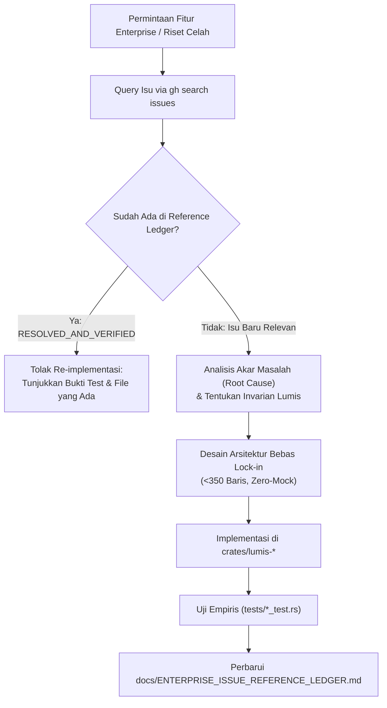

# 🔭 Lumis Gap Resolver & Issue Research Skill

Skill ini menyediakan prosedur operasional untuk meriset celah fungsional, isu terbuka (*open issues*), dan isu yang telah ditutup (*closed issues*) dari repositori pembanding (`LibreChat-AI/LibreChat`, `Llumen`) langsung menggunakan **GitHub CLI (`gh`)**, mencatatnya dalam **Issue Reference Ledger**, dan mengintegrasikannya ke dalam roadmap pengembangan Lumis tanpa duplikasi kerja.

---

## 🎯 Kapan Menggunakan Skill Ini

1. **Sebelum Merancang / Mengimplementasikan Fitur Baru**:
   - Memeriksa apakah fitur atau arsitektur yang akan dibuat memiliki riwayat *bug* atau *operational friction* pada LibreChat atau Llumen.
2. **Saat Menghadapi Permintaan Integrasi Enterprise**:
   - Menganalisis isu terkait Kubernetes, Coolify, Traefik, SSO/OIDC, SSE streaming, dan RAG di repositori upstream.
3. **Untuk Memperbarui & Menjaga Kerapian Ledger**:
   - Menjaga integritas [`docs/ENTERPRISE_ISSUE_REFERENCE_LEDGER.md`](../../docs/ENTERPRISE_ISSUE_REFERENCE_LEDGER.md) agar selalu mutakhir dan mencegah penanganan ulang terhadap masalah yang sudah terselesaikan.

---

## 🛠️ Prosedur Riset Langsung via GitHub CLI (`gh`)

> [!IMPORTANT]
> **Gunakan `gh` CLI Langsung**:
> Hindari web search umum yang tidak terstruktur jika data dapat diambil langsung dari issue GitHub resmi. Pastikan menggunakan organisasi repositori yang benar (`LibreChat-AI/LibreChat`).

### 1. Pencarian Isu Spesifik Domain
```bash
# Mencari isu terkait streaming, SSE, dan proxy timeout
gh search issues --repo LibreChat-AI/LibreChat "SSE timeout" --limit 10 --json number,title,state,url

# Mencari isu terkait Kubernetes, Ingress, dan Helm
gh search issues --repo LibreChat-AI/LibreChat "kubernetes" --limit 10 --json number,title,state,url

# Mencari isu terkait OIDC / Keycloak / Entra ID
gh search issues --repo LibreChat-AI/LibreChat "OIDC group sync" --limit 10 --json number,title,state,url

# Mencari isu terkait RAG / vector indexing / file upload
gh search issues --repo LibreChat-AI/LibreChat "RAG embeddings" --limit 10 --json number,title,state,url

# Mencari isu terkait database contention / MongoDB / PostgreSQL
gh search issues --repo LibreChat-AI/LibreChat "mongodb contention" --limit 10 --json number,title,state,url
```

### 2. Membaca Detail Isu Tertarget
```bash
gh issue view <ISSUE_NUMBER> --repo LibreChat-AI/LibreChat --json title,body,comments
```

---

## 📐 Alur Kerja Pengambilan Keputusan (Decision Flow)



---

## 🛡️ Aturan Emas Arsitektur Lumis

Setiap solusi yang dirancang untuk menutup celah dari LibreChat/Llumen WAJIB mematuhi:
1. **Single Binary Footprint**: Tidak boleh menambah container sidecar baru (seperti decoupled Python FastAPI RAG). Seluruh logika berjalan in-process di Rust (<25MB RAM).
2. **Relational Driver Agnostic**: Mendukung SQLite WAL (edge zero-ops) dan PostgreSQL Connection Pool secara instan via `DATABASE_URL`.
3. **Hard Line Limit**: 100% berkas wajib `< 350 lines` per berkas.
4. **Dual-Tier Zero-Mock**: Lolos audit statis `detect-mocks .` dan divalidasi dengan tes *Sentinel Round-Trip* serta *Fault Injection*.
