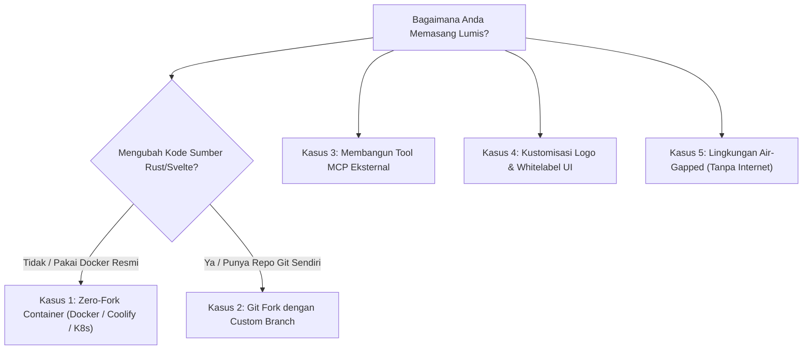

# 🚀 Downstream Developer & Operator Update Guide

> **Panduan Resmi Pembaruan Sistem Hilir Lumis AI Gateway**  
> **Model Arsitektur**: Upstream Canonical (`ihkaru/lumis`) $\rightarrow$ Downstream Consumers  
> **Standar Garansi**: SemVer 2.0.0, Zero-Breakage Contract, Automated Idempotent Migrations

Dokumen ini adalah panduan lengkap bagi pengembang, *DevOps engineer*, dan instansi/satker yang mengadopsi atau membangun sistem di atas **Lumis AI Gateway**, agar dapat melakukan pembaruan versi secara **mudah, aman, dan tanpa downtime** (*seamless*).

---

## 🧭 Matriks Skenario Pembaruan Hilir

Pilih skenario yang sesuai dengan metode deployment Anda:



---

## 📦 Kasus 1: Zero-Fork Container Deployer (Docker / Coolify / K8s)
> **Cocok Untuk**: 90% tim operasional, sysadmin, dan satker (termasuk implementasi BPS Mempawah).  
> **Waktu Eksekusi**: < 1 menit.  
> **Risiko Kerusakan**: **0% (Zero Breaking Changes)** pada rilis Patch & Minor.

### Langkah Pembaruan (Docker Compose):
1. **Tarik Image Resmi Terbaru**:
   ```bash
   docker compose pull
   ```
2. **Nyalakan Ulang Kontainer (Rolling Restart)**:
   ```bash
   docker compose up -d
   ```
3. **Mekanisme Otomatis**:
   - Kontainer baru otomatis menjalankan migrasi skema database relasional idempoten (`driver.run_migrations()`).
   - Sesi percakapan, memori pengguna, dan kredensial lama tidak akan terhapus.

### Langkah Pembaruan di Coolify:
1. Buka dashboard Coolify $\rightarrow$ Pilih aplikasi Lumis.
2. Klik tombol **Deploy** atau kirim Webhook Deploy.

---

## 🔄 Kasus 2: Downstream Git Forker (Punya Custom Code / Branch)
> **Cocok Untuk**: Pengembang yang memodifikasi backend/frontend atau mengelola fork resmi (misal: `ipds6104/lumis`).

### 1. Konfigurasi Remote Upstream (Cukup Sekali)
Pastikan repositori lokal Anda memiliki remote `upstream` yang mengarah ke `ihkaru/lumis`:
```bash
git remote add upstream https://github.com/ihkaru/lumis.git
git fetch upstream
```

### 2. Melakukan Sinkronisasi Versi Baru
#### Opsi A: Fast-Forward Merge (Rekomendasi Utama)
Jika cabang `main` Anda tidak memiliki commit kustom yang bertabrakan dengan core:
```bash
git checkout main
git fetch upstream
git merge upstream/main --ff-only || git merge upstream/main -m "chore(sync): update from upstream $(git describe --tags upstream/main)"
git push origin main
```

#### Opsi B: Rebase pada Cabang Kustom Instansi (`custom-branch`)
Jika instansi Anda menyimpan modifikasi internal pada cabang terpisah (misal: `bps-custom`):
```bash
git checkout bps-custom
git fetch upstream
git rebase upstream/main
# Jika ada konflik, selesaikan file konflik lalu:
# git add <file> && git rebase --continue
git push origin bps-custom --force-with-lease
```

> [!TIP]
> **Praktik Terbaik Menghindari Konflik**:  
> Selalu pisahkan modifikasi internal ke dalam folder kustom atau manfaatkan *environment variables* / Model Context Protocol (MCP) alih-alih mengedit berkas inti di `crates/lumis-server/src/`.

---

## 🛠️ Kasus 3: Pengembang Ekstensi & Tool MCP (AI Engineer)
> **Cocok Untuk**: Pengembang yang mengintegrasikan bot, agen autonomous, atau server MCP kustom ke Lumis.

Lumis menjamin stabilitas antarmuka REST API dan kontrak tool eksternal:
1. **Periksa CHANGELOG.md**:
   - Periksa rilis target pada [`CHANGELOG.md`](../CHANGELOG.md) di bagian `Changed` atau `Deprecated`.
2. **Kepatuhan Protokol MCP 2026**:
   - Seluruh endpoint MCP (`/api/mcp/tools`, `/api/mcp/tasks`, `/api/mcp/approvals`) bersifat *backward-compatible*.
3. **Verifikasi Registrasi Tool Setelah Update**:
   ```bash
   curl -s -H "x-forwarded-user: admin" https://chat.domain-anda.id/api/mcp/tools | jq .
   ```

---

## 🎨 Kasus 4: Whitelabeling & Injeksi Aset UI
> **Cocok Untuk**: Instansi yang ingin mengganti logo, favicon, atau nama aplikasi tanpa harus meng-compile ulang Svelte.

Lumis mendukung **Runtime Overlay Injection**:
1. **Nama & Brand Title**:
   Ubah variabel `LUMIS_BRAND_TITLE` di file `.env` tanpa re-deploy code:
   ```bash
   LUMIS_BRAND_TITLE="Portal AI Internal Perusahaan"
   ```
2. **Logo & Favicon Kustom**:
   Cukup mount berkas gambar lokal ke dalam direktori statis kontainer pada `docker-compose.yml`:
   ```yaml
   volumes:
     - ./my-agency-logo.svg:/app/ui/dist/logo.svg:ro
     - ./my-favicon.ico:/app/ui/dist/favicon.ico:ro
   ```
   Saat kontainer Lumis di-update ke versi terbaru, logo kustom Anda tetap utuh!

---

## 🔒 Kasus 5: Lingkungan Terisolasi / Air-Gapped (Pemerintahan & Bank)
> **Cocok Untuk**: Server intranet tanpa akses internet langsung ke GitHub Container Registry (GHCR).

### 1. Di Komputer Online:
Ekspor image kontainer resmi menjadi arsip tarball:
```bash
docker pull ghcr.io/ihkaru/lumis:v1.0.0
docker save ghcr.io/ihkaru/lumis:v1.0.0 | gzip > lumis-v1.0.0.tar.gz
```

### 2. Di Server Air-Gapped:
Transfer arsip via media resmi / secure bastion, lalu impor:
```bash
gunzip -c lumis-v1.0.0.tar.gz | docker load
```
Perbarui tag pada `docker-compose.yml` lokal ke `ghcr.io/ihkaru/lumis:v1.0.0`, lalu jalankan:
```bash
docker compose up -d
```

---

## 🩺 Protokol Diagnostik Pasca-Pembaruan (Health Check)

Setelah memperbarui versi, lakukan 3 verifikasi mandatori:

1. **Pemeriksaan Liveness Server**:
   ```bash
   curl -i https://chat.domain-anda.id/health
   # Ekspektasi: HTTP 200 OK
   ```

2. **Pemeriksaan Integritas Basis Data**:
   ```bash
   curl -s https://chat.domain-anda.id/health/db | jq .
   # Ekspektasi: "is_alive": true, latency_ms <= 5ms
   ```

3. **Diagnostik Menyeluruh (System Doctor)**:
   ```bash
   curl -s https://chat.domain-anda.id/api/system/doctor | jq .
   # Ekspektasi: status "healthy", seluruh driver terverifikasi
   ```

---

## 🚨 Prosedur Pemulihan Darurat (Rollback Strategy)

Jika terjadi kendala tak terduga pada versi baru:
1. Kembalikan image tag di `docker-compose.yml` ke versi sebelumnya (misal: `ghcr.io/ihkaru/lumis:v1.0.0`).
2. Jalankan `docker compose up -d`.
3. Karena Lumis menerapkan prinsip **Expand & Contract**, skema basis data versi baru tetap kompatibel jika dibaca oleh biner versi sebelumnya.
