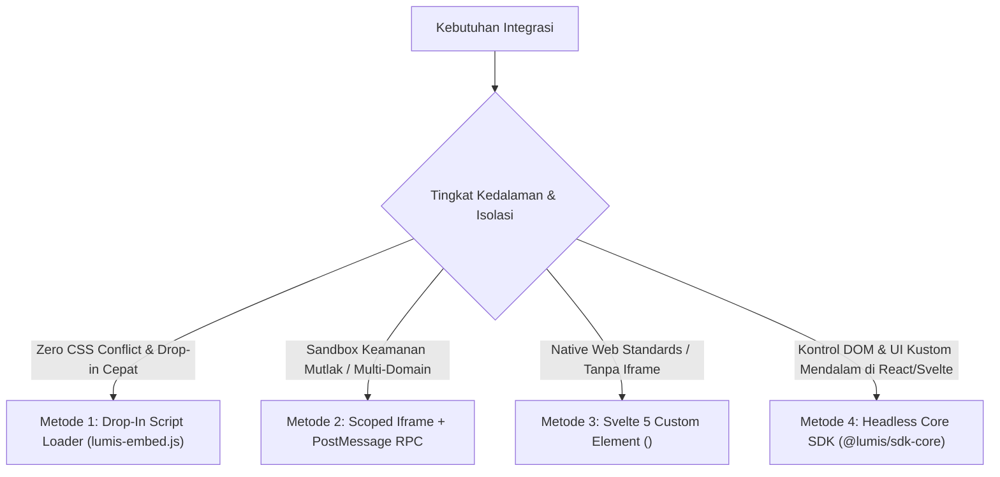

# 🧩 Panduan Integrasi & Embed Lumis Chat ke Existing SPA

Dokumen ini adalah panduan komprehensif bagi tim pengembang untuk mengintegrasikan atau meng-embed antarmuka dan mekanisme percakapan cerdas **Lumis** ke dalam aplikasi Single Page Application (SPA) yang sudah ada (React, Vue, Angular, Svelte, atau Vanilla HTML/JS) secara aman, modular, dan mulus (*zero context switching*).

---

## 🎯 4 Pendekatan Integrasi (Pilih Sesuai Kebutuhan)



---

## 🚀 Metode 1: 1-Line Drop-In Script Loader (`lumis-embed.js`)
*Pilihan tercepat untuk menyematkan floating chat widget di website atau portal enterprise internal.*

Cukup tempelkan baris script berikut sebelum penutup tag `</body>`:

```html
<script
  src="https://lumis.company.com/lumis-embed.js"
  data-server-url="https://lumis.company.com"
  data-token="EMBED_TOKEN_DARI_BACKEND_ANDA"
  data-position="bottom-right"
  data-title="Lumis Enterprise Assistant"
  data-theme="auto"
  async>
</script>
```

Atau inisialisasi secara dinamis via JavaScript:

```javascript
import { initLumisWidget } from "@lumis/embed";

const widget = initLumisWidget({
  serverUrl: "https://lumis.company.com",
  embedToken: await fetchEmbedTokenFromBackend(),
  position: "bottom-right", // atau "bottom-left"
  title: "BPS AI Assistant",
  contextData: {
    active_module: "Kepegawaian",
    current_employee_id: "199401122018011001"
  }
});

// Kontrol Programatik:
widget.open();
widget.sendPrompt("Bantu saya rekap data bulan ini");
```

---

## 🔒 Metode 2: Scoped Iframe + PostMessage RPC
*Pilihan terbaik jika aplikasi host memiliki aturan CSS yang agresif atau kebijakan keamanan CSP ketat.*

### 1. Pasang Iframe di Halaman Host
```html
<iframe
  id="lumis-chat-frame"
  src="https://lumis.company.com/embed/chat?token=EMBED_TOKEN&origin=https://my-spa.corp"
  style="width: 100%; height: 600px; border: none; border-radius: 12px;"
  allow="clipboard-write">
</iframe>
```

### 2. Komunikasi Dwiarah PostMessage (RFC 6454 Safe)
```javascript
const frame = document.getElementById("lumis-chat-frame");
const LUMIS_ORIGIN = "https://lumis.company.com";

// Mendengarkan event dari Lumis Widget
window.addEventListener("message", (event) => {
  if (event.origin !== LUMIS_ORIGIN) return; // Validasi origin wajib!
  const { source, event: evtName, payload, correlation_id } = event.data || {};
  if (source !== "lumis-widget") return;

  if (evtName === "lumis:ready") {
    // Widget siap menerima konteks
    frame.contentWindow.postMessage({
      source: "host-app",
      event: "lumis:set_context",
      payload: { active_table_filter: "rejected" }
    }, LUMIS_ORIGIN);
  }
});
```

---

## ⚛️ Metode 3: Integrasi Native di React SPA
*Menggunakan Headless SDK `@lumis/sdk-core` untuk integrasi reaktif penuh dengan state React.*

```tsx
import React, { useEffect, useState } from "react";
import { HttpSseTransport, createLumisChat } from "@lumis/sdk-core";

export function EmbeddedAssistant({ userToken, documentId }: { userToken: string; documentId: string }) {
  const [engine] = useState(() => {
    const transport = new HttpSseTransport({ baseUrl: "https://lumis.company.com", embedToken: userToken });
    return createLumisChat(transport, { contextData: { document_id: documentId } });
  });

  useEffect(() => {
    engine.initStream();
    return () => engine.disconnectStream();
  }, [engine]);

  return (
    <div className="flex flex-col h-[500px] border rounded-xl overflow-hidden">
      <div className="p-3 bg-slate-100 font-semibold text-sm">Lumis In-App Assistant</div>
      <div className="flex-1 overflow-y-auto p-4 space-y-3">
        {engine.messages.map((msg) => (
          <div key={msg.id} className={msg.role === "user" ? "text-right" : "text-left"}>
            <span className="inline-block p-2 rounded-lg bg-slate-200 text-sm">{msg.content}</span>
          </div>
        ))}
      </div>
      <form onSubmit={(e) => {
        e.preventDefault();
        const input = (e.currentTarget.elements.namedItem("prompt") as HTMLInputElement);
        if (input.value) { engine.sendMessage(input.value); input.value = ""; }
      }} className="p-2 border-t flex gap-2">
        <input name="prompt" className="flex-1 border rounded px-3 py-1.5 text-sm" placeholder="Ketik pesan..." />
        <button type="submit" disabled={engine.isGenerating} className="bg-blue-600 text-white px-4 py-1.5 rounded text-sm">Kirim</button>
      </form>
    </div>
  );
}
```

---

## 🟢 Metode 4: Integrasi di Vue 3 SPA (Composition API)
*Integrasi reaktif dengan Vue 3 `ref` & `@lumis/sdk-core`.*

```vue
<script setup lang="ts">
import { ref, onMounted, onUnmounted } from "vue";
import { HttpSseTransport, createLumisChat } from "@lumis/sdk-core";

const props = defineProps<{ token: string; contextId: string }>();
const inputPrompt = ref("");

const transport = new HttpSseTransport({ baseUrl: "https://lumis.company.com", embedToken: props.token });
const engine = createLumisChat(transport, { contextData: { row_id: props.contextId } });

onMounted(() => engine.initStream());
onUnmounted(() => engine.disconnectStream());

function handleSend() {
  if (!inputPrompt.value.trim()) return;
  engine.sendMessage(inputPrompt.value);
  inputPrompt.value = "";
}
</script>

<template>
  <div class="chat-wrapper border rounded-lg p-4 flex flex-col h-[500px]">
    <div class="messages flex-1 overflow-y-auto space-y-2">
      <div v-for="m in engine.messages" :key="m.id" :class="m.role === 'user' ? 'text-right' : 'text-left'">
        <span class="inline-block bg-muted p-2 rounded text-sm">{{ m.content }}</span>
      </div>
    </div>
    <div class="input-bar flex gap-2 pt-2 border-t">
      <input v-model="inputPrompt" @keyup.enter="handleSend" class="border flex-1 px-3 py-1 text-sm rounded" placeholder="Ketik pesan..." />
      <button :disabled="engine.isGenerating" @click="handleSend" class="bg-primary text-primary-foreground px-4 py-1 rounded text-sm">Kirim</button>
    </div>
  </div>
</template>
```

---

## 🕹️ Live Interactive Demo Fixture
Untuk menguji coba seluruh kapabilitas embed secara langsung di browser lokal Anda tanpa setup server kompleks:

1. Jalankan backend Lumis: `cargo run -p lumis-server` (port 8080).
2. Jalankan demo HTML bawaan:
   ```bash
   bunx serve examples
   # Buka http://localhost:3000/vanilla-embed-demo.html
   ```
Demo interaktif di [`examples/vanilla-embed-demo.html`](../examples/vanilla-embed-demo.html) mendemonstrasikan secara visual:
- Buka / Tutup floating widget secara programatik (`open()`, `close()`).
- Auto-inject konteks aplikasi host (`userContext`).
- Eksekusi in-app tool calling (`highlight_row`, `copy_sku`).

---

## 📋 Checklist Produksi (Pre-Flight to Production)

- [ ] **1. Konfigurasi CORS Server**: Pastikan `CORS_ALLOWED_ORIGINS` diatur di environment Lumis Server dengan origin domain SPA host Anda (misal `https://app.corp.com`).
- [ ] **2. Tentukan Kebijakan Frame Ancestors**: Untuk integrasi Iframe, atur `CSP_FRAME_ANCESTORS="https://app.corp.com"` agar browser mengizinkan pemuatan frame.
- [ ] **3. Backend Token Broker**: Pastikan aplikasi backend Anda memiliki endpoint proxy yang memanggil `POST /api/auth/embed-token` di Lumis menggunakan Master API Key, kemudian mengembalikan ephemeral token ke frontend.
- [ ] **4. Error & Auto-Refresh Handling**: Tangani event token expired (HTTP 401) dengan meminta token baru secara transparan tanpa mengganggu percakapan aktif.
- [ ] **5. In-App Tool Safety**: Selalu validasi argumen yang dikirim model sebelum mengeksekusi aksi mutatif di sisi host aplikasi.

---

## ❓ Panduan Pemecahan Masalah (Troubleshooting)

| Gejala Masalah | Kemungkinan Penyebab | Solusi Cepat |
| :--- | :--- | :--- |
| `Blocked by CORS policy` | Origin SPA belum terdaftar di backend Lumis | Tambahkan origin di `CORS_ALLOWED_ORIGINS="https://domain-anda.com"` lalu restart server. |
| `Refused to display in a frame (CSP)` | Header `frame-ancestors` menolak domain host | Konfigurasikan CSP di reverse proxy atau set origin terpercaya di parameter query `/embed/chat?origin=...`. |
| `401 Unauthorized / Token Expired` | Ephemeral embed token telah melewati batas TTL (15-30m) | Minta token baru via endpoint backend Anda dan panggil `transport.updateToken(newToken)`. |
| `PostMessage event ignored` | Nilai `event.origin` tidak sesuai dengan domain Lumis | Pastikan script host memeriksa `event.origin === LUMIS_SERVER_ORIGIN` secara presisi. |

---

## 🔑 Backend: Cara Menghasilkan Ephemeral Embed Token

Host backend Anda menghasilkan token aman jangka pendek (15–30 menit) menggunakan endpoint `POST /api/auth/embed-token` di Lumis:

```bash
curl -X POST https://lumis.company.com/api/auth/embed-token \
  -H "Content-Type: application/json" \
  -H "Authorization: Bearer MASTER_API_KEY_ANDA" \
  -d '{
    "external_user_id": "usr_karyawan_1982",
    "username": "budi.santoso",
    "tenant_id": "bps",
    "roles": ["member"],
    "email": "budi@bps.go.id",
    "ttl_seconds": 1800
  }'
```

**Respons JSON:**
```json
{
  "token": "lumis_embed_v1.eyJzdWIiOiJ1c3Jfa2FyeWF3YW5fMTk4MiIsImV4cCI6MTcyOTc4NDk5Mn0....signature",
  "user_id": "usr_karyawan_1982",
  "expires_at": 1729784992
}
```

Token ini diserahkan ke browser frontend Host SPA untuk mengotentikasi obrolan Lumis tanpa membagikan kredensial login atau cookie utama.

---

## 🛠️ Agentic In-App Tools (Model AI Memanggil Aksi di Aplikasi Host)

Anda dapat mendaftarkan fungsi JavaScript di aplikasi host yang dapat dipanggil langsung oleh model AI:

```javascript
widget.registerTool({
  name: "navigate_dashboard",
  description: "Pindah ke halaman tertentu pada dashboard aplikasi",
  parameters: {
    route: "string (contoh: /laporan atau /profil)"
  },
  execute: async ({ route }) => {
    // Navigasi router host aplikasi Anda (misal: react-router / vue-router)
    myAppRouter.push(route);
    return { success: true, message: `Berhasil diarahkan ke ${route}` };
  }
});
```

---

## 🛡️ Praktik Terbaik Keamanan & Kepatuhan CISO

1. **Konfigurasi CORS**: Tentukan domain resmi host pada environment variable Lumis Server:
   `CORS_ALLOWED_ORIGINS="https://portal.bps.go.id,https://admin.bps.go.id"`
2. **Validasi Origin**: Selalu periksa `event.origin` saat menangani pesan `postMessage`.
3. **Masa Berlaku Token Pendek**: Terapkan masa berlaku token embed antara 15 hingga 60 menit.
4. **Isolasi Konteks Data**: Manfaatkan `contextData` (EIP Content Enricher) untuk menyuntikkan ID entitas aktif tanpa membocorkan token rahasia ke prompt pengguna.

---

## 🧠 Arsitektur Memori, Sesi & Topologi Backend (Best Practice 2026)

### 1. Dukungan Lapisan Memori & Percakapan (Out-of-the-Box)
Lumis telah mengintegrasikan arsitektur memori 3-tier secara *native*:
- **Tier 1: Episodic / Sesi Percakapan**: Thread history tersimpan di SQLite WAL / PostgreSQL dengan keyset pagination $\mathcal{O}(\log N)$ dan pemangkasan otomatis (*sliding window pruning*) berbasis token budget (`DEFAULT_MAX_CONTEXT_TOKENS`) agar tidak terjadi context overflow.
- **Tier 2: Semantic / Long-Term User Memory**: Tabel `user_memories` (`/api/memories`) menyimpan fakta & preferensi pengguna lintas sesi yang otomatis diinjeksi ke system prompt saat inferensi.
- **Tier 3: Procedural / Contextual Knowledge**: Integrasi Knowledge Vault RAG dan protokol MCP 2026 untuk tool calling cerdas.

### 2. Apakah Aplikasi Host Perlu Menjalankan Full Backend Sendiri?
- **Pola 1: Centralized AI Gateway (Rekomendasi Terbaik Industri)**:
  Lumis Server di-host terpusat sebagai microservice kontainer ultra-ringan (<35MB image, <25MB RAM). Aplikasi SPA host **TIDAK PERLU** membuat backend AI, database vektor, atau logika streaming SSE sendiri. Backend host hanya membutuhkan 1 endpoint broker token (~5 baris kode) untuk memanggil `POST /api/auth/embed-token`.
- **Pola 2: BYOB (Bring Your Own Backend via `ILumisTransport`)**:
  Jika tim pengembang *sudah memiliki* backend AI internal (misal FastAPI / NestJS / LangGraph) dan hanya ingin memanfaatkan Chat UI & State Engine Lumis, pengembang cukup mengimplementasikan kontrak interface [`ILumisTransport`](../ui/src/lib/sdk/types.ts) di sisi frontend tanpa perlu meng-host `lumis-server`.
