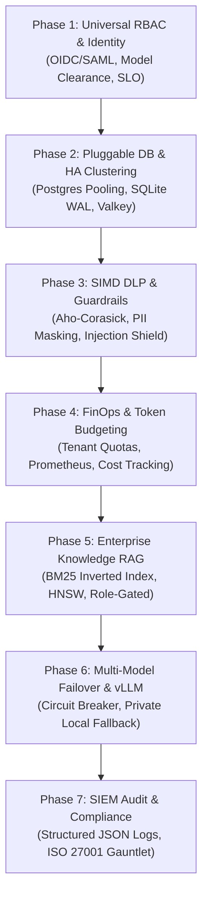

# 🗺️ Master Roadmap: Enterprise Lumis AI Platform

Dokumen ini adalah peta jalan strategis multi-fase untuk mengembangkan **Lumis** menjadi platform percakapan kecerdasan artifisial skala enterprise yang mandiri, berlisensi MIT permisif, ultra-ringan (<25MB RAM), dan mendukung arsitektur multi-database terdistribusi.

---

## 🎯 Visi & Sasaran Strategis Lumis

1. **Sepenuhnya Terfederasi (Zero-Trust Identity)**: Autentikasi SSO OIDC/SAML, otorisasi berjenjang universal (`super_admin` s.d. `guest`), dan klirens model AI bertingkat.
2. **Pluggable Multi-Database (High Availability & Zero Lock-in)**: Bebas beralih antara SQLite WAL (edge/standalone) dan PostgreSQL cluster (enterprise high-concurrency) via Interface-First DIP.
3. **Kinerja Ekstrem & Algoritma Mutakhir ($\mathcal{O}(1)$ & $\mathcal{O}(\log N)$)**: Zero-copy token streaming (`bytes::Bytes`), keyset cursor pagination, dan SIMD Aho-Corasick PII filtering.
4. **Keamanan CISO & Kepatuhan Regulasi**: Pencegahan kebocoran data rahasia (UU PDP, GDPR, SOC 2, ISO 27001), killswitch instan, dan revokasi sesi sub-milidetik.
5. **Kaya Pengetahuan Institusional (Hybrid RAG)**: Pencarian semantik dan full-text terintegrasi dengan akses data terisolasi per peran.

---

## 📊 Matriks 7 Fase Pengembangan

| Fase | Dokumen Roadmap | Fokus Utama | Luaran Kunci |
| :---: | :--- | :--- | :--- |
| **01** | [Phase 1: Universal RBAC](01_PHASE_1_IDENTITY_FEDERATION_AND_RBAC.md) | Otorisasi berjenjang & klirens model | 5-level RBAC, canonical alias map, header enrichment |
| **02** | [Phase 2: Pluggable DB & HA](02_PHASE_2_HIGH_AVAILABILITY_AND_REPLICATION.md) | Multi-database & klaster HA | PostgreSQL pooler, SQLite WAL mmap, Valkey cache |
| **03** | [Phase 3: SIMD Guardrails](03_PHASE_3_ADVANCED_DLP_AND_PROMPT_GUARDRAILS.md) | Pencegahan kebocoran data | Aho-Corasick SIMD, PII masking, injection defense |
| **04** | [Phase 4: FinOps & Quotas](04_PHASE_4_FINOPS_TOKEN_BUDGETING_AND_METRICS.md) | Pengendalian biaya token | Per-user token quota, Prometheus metrics, alerting |
| **05** | [Phase 5: Enterprise RAG](05_PHASE_5_ENTERPRISE_RAG_AND_KNOWLEDGE_VAULT.md) | Pengetahuan dokumen rahasia | Inverted index FTS5, vector embeddings, role filters |
| **06** | [Phase 6: Failover & vLLM](06_PHASE_6_MODEL_FAILOVER_AND_PRIVATE_VLLM.md) | Ketahanan & ketersediaan SLA | Circuit breaker, private on-prem fallback (vLLM/Ollama) |
| **07** | [Phase 7: SIEM & Audit](07_PHASE_7_SIEM_AUDIT_LOGGING_AND_COMPLIANCE.md) | Kepatuhan hukum & audit SOC | Structured JSON logs, SOC 2 & ISO 27001 compliance |

---

## 🛡️ Tata Kelola Rekayasa (Old-Coder Protocol)

1. **Interface-First Principle**: Seluruh kontrak interface/trait didefinisikan sebelum implementasi konkret.
2. **Batas Baris Deterministik**: 100% berkas wajib berukuran `< 350 lines` (`bash scripts/check-line-limits.sh`).
3. **Zero-Mock di Jalur Produksi**: Dilarang menggunakan mock data palsu pada implementasi sistem.
4. **Verifikasi Bukti Empiris**: Setiap tahapan wajib divalidasi dengan test assertions (`cargo test --workspace`).
