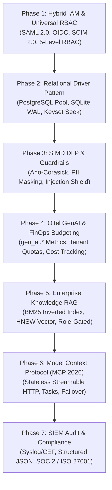

# 🗺️ Master Roadmap: Enterprise Lumis AI Platform

Dokumen ini adalah peta jalan strategis multi-fase untuk mengembangkan **Lumis** menjadi platform percakapan kecerdasan artifisial skala enterprise yang **minim hambatan adopsi (*zero friction enterprise adoption*)**, berlisensi MIT permisif, ultra-ringan (<25MB RAM), dan mendukung sinergi antara **standar warisan enterprise (*legacy standards*)** dan **standar mutakhir per Oktober 2026 (MCP 2026, OTel GenAI)**.

---

## 🎯 Visi & Prinsip "Zero Friction Enterprise Adoption"

1. **Kompatibilitas Identitas Hibrida (Legacy SAML/AD + Modern OIDC/SCIM)**:
   - Dukungan langsung (*drop-in*) terhadap IdP institusional lama (Active Directory, LDAP, SAML 2.0, rIDM) maupun modern (Keycloak, Okta, Microsoft Entra ID) dengan otomasi provisi SCIM 2.0.
2. **Relational Driver Pattern (Bebas Keterikatan Basis Data)**:
   - Abstraksi penyimpanan berbasis driver relasional murni (EIP Channel Adapter) tanpa lock-in: beralih instan antara **SQLite WAL** (zero-ops edge) dan **PostgreSQL cluster** (enterprise high-concurrency) via `DATABASE_URL`.
3. **Ekosistem AI Agen Modern (MCP 2026 - AAIF / Linux Foundation)**:
   - Kepatuhan terhadap spesifikasi Model Context Protocol mutakhir 2026: *Stateless Remote Protocol*, Streamable HTTP/SSE, Asynchronous Tasks, dan Enterprise Managed Authorization (EMA).
4. **Observabilitas Standar Industri (OpenTelemetry GenAI 2026)**:
   - Telemetri siap pakai dengan konvensi semantik OTel `gen_ai.*` untuk integrasi mulus ke APM enterprise (Datadog, Dynatrace, New Relic, Grafana).
5. **Kinerja Ekstrem & Keamanan CISO Terverifikasi**:
   - Zero-copy token streaming (`bytes::Bytes`), keyset pagination $\mathcal{O}(\log N)$, dan SIMD Aho-Corasick PII filtering.

---

## 📊 Matriks 7 Fase Pengembangan Lumis

| Fase | Dokumen Roadmap | Standar Legacy Didukung | Standar Modern 2026 Didukung |
| :---: | :--- | :--- | :--- |
| **01** | [Phase 1: Hybrid IAM & RBAC](01_PHASE_1_IDENTITY_FEDERATION_AND_RBAC.md) | SAML 2.0, LDAP/Active Directory, NIP claims | OAuth 2.1 (PKCE), SCIM 2.0, Universal 5-Level RBAC |
| **02** | [Phase 2: Relational Driver Pattern](02_PHASE_2_HIGH_AVAILABILITY_AND_REPLICATION.md) | ANSI SQL-99/2016, PostgreSQL, SQLite | Keyset Cursor Seek $\mathcal{O}(\log N)$, RelationalDriver Trait |
| **03** | [Phase 3: SIMD Guardrails](03_PHASE_3_ADVANCED_DLP_AND_PROMPT_GUARDRAILS.md) | Regex PII matching (NIK/NIP/NPWP) | SIMD Aho-Corasick linear $\mathcal{O}(N+Z)$, OWASP Top 10 LLM |
| **04** | [Phase 4: OTel GenAI & FinOps](04_PHASE_4_FINOPS_TOKEN_BUDGETING_AND_METRICS.md) | Prometheus metrics, token counter | OpenTelemetry GenAI (`gen_ai.*`), token histograms |
| **05** | [Phase 5: Enterprise RAG](05_PHASE_5_ENTERPRISE_RAG_AND_KNOWLEDGE_VAULT.md) | Lexical search, document tagging | Hybrid RAG (BM25 + HNSW), role-gated retrieval |
| **06** | [Phase 6: MCP 2026 & Failover](06_PHASE_6_MODEL_FAILOVER_AND_PRIVATE_VLLM.md) | Circuit breaker, REST webhook | MCP 2026 (AAIF Stateless HTTP), Async Tasks, EMA |
| **07** | [Phase 7: SIEM & Audit](07_PHASE_7_SIEM_AUDIT_LOGGING_AND_COMPLIANCE.md) | Syslog (RFC 5424), CEF, Splunk HEC | ECS Structured JSON, SOC 2 Type II, UU PDP No. 27/2022 |

---

## 🛡️ Tata Kelola Rekayasa (Old-Coder Protocol)

1. **Interface-First Principle**: Seluruh kontrak interface/trait didefinisikan sebelum implementasi konkret.
2. **Batas Baris Deterministik**: 100% berkas wajib berukuran `< 350 lines` (`bash scripts/check-line-limits.sh`).
3. **Zero-Mock di Jalur Produksi**: Dilarang menggunakan mock data palsu pada implementasi sistem.
4. **Verifikasi Bukti Empiris**: Setiap tahapan wajib divalidasi dengan test assertions (`cargo test --workspace`).
