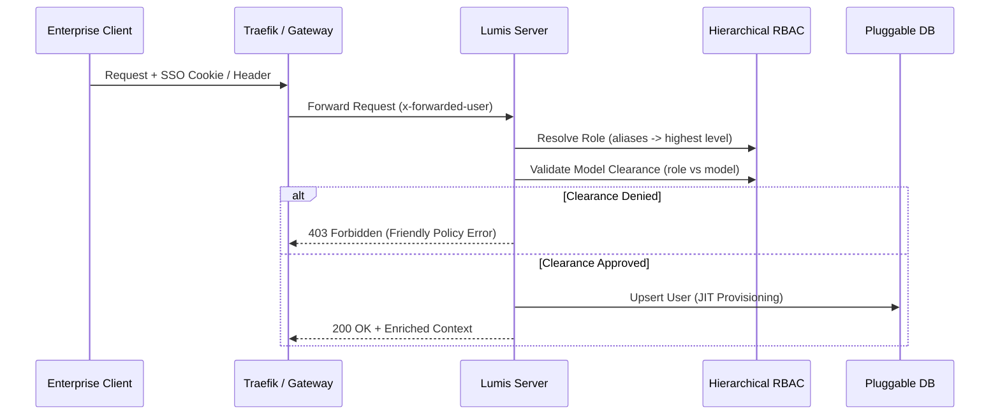

# 🏛️ Phase 1: Universal Hierarchical RBAC & Identity Federation

Fase ini mematangkan federasi identitas enterprise dengan otorisasi berjenjang universal (*Universal Hierarchical RBAC*), pemetaan alias otomatis, dan batas klirens model AI (*Model Clearance Tiers*).

---

## 🎯 Sasaran Utama

1. **Universal Hierarchical RBAC (5 Tingkat Berjenjang Monotonik)**:
   - `super_admin` (Level 5): Kendali platform global, CISO controls, audit SIEM, killswitch, akses tak terbatas ke semua model.
   - `tenant_admin` (Level 4): Administrator departemen/divisi/satker, pengawasan kuota divisi.
   - `power_user` (Level 3): Insinyur/developer, analis data, operator; akses ke model penalaran (*frontier reasoning models*) & kuota tinggi.
   - `member` (Level 2): Pengguna standar enterprise, staf internal; akses penuh ke model korporat standar.
   - `guest` (Level 1): Pengguna eksternal, kontraktor, auditor, akun tamu; dibatasi pada model hemat (*tier_basic*).

2. **Pemetaan Alias Kanonikal (Backward Compatibility & Institutional Federation)**:
   - `super_admin` ← `admin`, `ciso`, `root`, `system_admin`, `security_officer`.
   - `tenant_admin` ← `dept_admin`, `division_head`, `satker_admin`, `manager`, `org_admin`.
   - `power_user` ← `operator`, `lead`, `developer`, `engineer`, `analyst`, `ppk`.
   - `member` ← `pegawai`, `staff`, `employee`, `user`, `internal`, `asn`.
   - `guest` ← `viewer`, `external`, `contractor`, `auditor`, `intern`, `tamu`.

3. **Tingkatan Klirens Model AI (Model Clearance Tiers)**:
   - `tier_basic` (Level 1+ / `guest`): `gpt-4o-mini`, `gemini-1.5-flash`, `kimi-k3`.
   - `tier_standard` (Level 2+ / `member`): `gpt-4o`, `gemini-1.5-pro`, `claude-3-5-haiku`.
   - `tier_advanced` (Level 3+ / `power_user`): `claude-3-5-sonnet`, `deepseek-coder`, `qwen-2.5-coder`.
   - `tier_reasoning` (Level 3+ / `power_user`): `deepseek-r1`, `o1`, `o1-mini`, `o3-mini`.

---

## 📐 Arsitektur & Alur Verifikasi

---

## 📦 Komponen & Implementasi Terverifikasi

1. [x] [`lumis_core::models::user::EnterpriseRole`](file:///root/projects/lumis/crates/lumis-core/src/models/user.rs): Tipe enum berjenjang dengan metode `level()`, `from_str()`, dan pemetaan alias kanonikal.
2. [x] [`lumis_core::models::user::ModelClearanceTier`](file:///root/projects/lumis/crates/lumis-core/src/models/user.rs): Klirens model 4-tier.
3. [x] [`lumis_server::routes::auth`](file:///root/projects/lumis/crates/lumis-server/src/routes/auth.rs): Endpoint SSO JIT auto-provisioning.
4. [x] [`tests/role_test.rs`](file:///root/projects/lumis/crates/lumis-core/tests/role_test.rs): Gauntlet pengujian hierarki peran dan alias parsing.

---

## 🧪 Kriteria Keberhasilan & Gauntlet

- [x] Semua peran berhasil dipetakan dari token SSO/SAML tanpa ada peran tak dikenal yang mendapat eskalasi hak istimewa.
- [x] Pengguna `member` atau `guest` yang mencoba memanggil model penalaran (*deepseek-r1*, *o1*) ditolak secara ramah dengan status 403.
- [x] Prevalensi multi-role deterministik ke level hierarki tertinggi.
- [x] 100% berkas berukuran `< 350 lines` dan lulus verifikasi `cargo test`.
