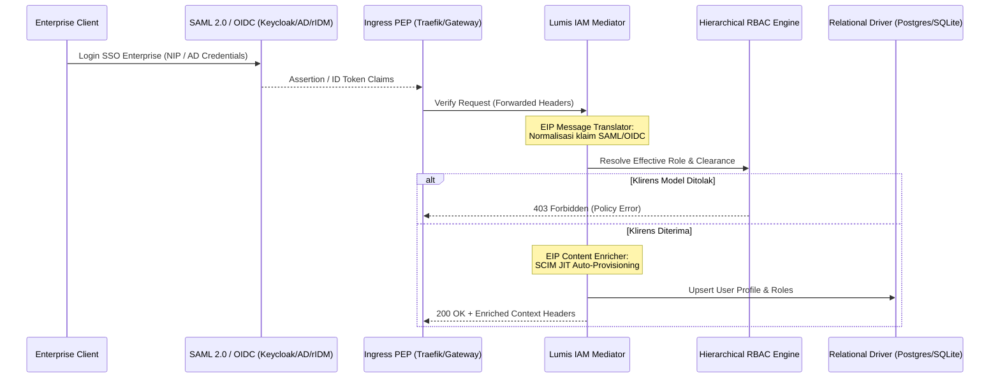

# 🏛️ Phase 1: Hybrid IAM Federation & Universal Hierarchical RBAC

Fase ini menghadirkan sistem identitas dan otorisasi enterprise tanpa hambatan (*zero friction*), menjembatani standar institusional warisan (**SAML 2.0, Active Directory/LDAP, NIP claims**) dengan standar modern (**OIDC Core 1.0, OAuth 2.1, SCIM 2.0, Universal 5-Level RBAC**).

---

## 🎯 Sasaran Utama & Standar Enterprise

1. **Kompatibilitas Identitas Hibrida (Legacy + Modern)**:
   - **SAML 2.0 & Active Directory**: Ekstraksi klaim dari header proxy (`X-Auth-Request-User`, `X-Forwarded-User`, `X-Auth-Request-Groups`) yang dihasilkan oleh broker IdP (Keycloak, Dex, OAuth2-Proxy, rIDM).
   - **OpenID Connect (OIDC) & OAuth 2.1**: Ekstraksi JWT claims standar (`sub`, `preferred_username`, `email`, `groups`, `tenant_id`).
   - **SCIM 2.0 (RFC 7643 / RFC 7644) Lifecycle**: Auto-provisioning akun (*Just-In-Time*), sinkronisasi profil, dan penonaktifan akun otomatis (*offboarding*).

2. **Universal Hierarchical RBAC (5 Tingkat Berjenjang Monotonik)**:
   - `super_admin` (Level 5): Kendali platform global, CISO controls, audit SIEM, killswitch, akses tak terbatas ke semua model AI.
   - `tenant_admin` (Level 4): Administrator departemen/divisi/satker, pengawasan kuota dan audit unit kerja.
   - `power_user` (Level 3): Insinyur, data analyst, operator AI; akses ke model penalaran (*frontier reasoning models*) & kuota tinggi.
   - `member` (Level 2): Pengguna standar enterprise, staf internal; akses penuh ke model korporat standar.
   - `guest` (Level 1): Pengguna eksternal, kontraktor sementara, auditor, akun tamu; dibatasi pada model hemat (*tier_basic*).

3. **Pemetaan Alias Kanonikal (Zero-Config Role Translation)**:
   - `super_admin` ← `admin`, `ciso`, `root`, `system_admin`, `security_officer`, `administrator`.
   - `tenant_admin` ← `dept_admin`, `division_head`, `satker_admin`, `kepala_satker`, `manager`, `org_admin`.
   - `power_user` ← `operator`, `lead`, `developer`, `engineer`, `analyst`, `specialist`, `ppk`.
   - `member` ← `pegawai`, `staff`, `employee`, `user`, `internal`, `asn`.
   - `guest` ← `viewer`, `external`, `contractor`, `auditor`, `intern`, `tamu`.

4. **Tingkatan Klirens Model AI (Model Clearance Tiers)**:
   - `tier_basic` (Level 1+ / `guest`): `gpt-4o-mini`, `gemini-1.5-flash`, `kimi-k3`.
   - `tier_standard` (Level 2+ / `member`): `gpt-4o`, `gemini-1.5-pro`, `claude-3-5-haiku`.
   - `tier_advanced` (Level 3+ / `power_user`): `claude-3-5-sonnet`, `deepseek-coder`, `qwen-2.5-coder`.
   - `tier_reasoning` (Level 3+ / `power_user`): `deepseek-r1`, `o1`, `o1-mini`, `o3-mini`.

---

## 📐 Pola Enterprise Integration Patterns (EIP)

---

## 📦 Komponen & Target Luaran

1. `lumis_core::models::user`: Definisi `EnterpriseRole`, `ModelClearanceTier`, `UserClaims`.
2. `lumis_core::traits::iam`: Kontrak `HierarchicalRbacEngine` dan `ClaimTranslator`.
3. `lumis_server::routes::auth`: Handler `/api/auth/me` dan `/api/admin/roles`.
4. `lumis_server::middleware::rbac`: Policy Enforcement Point (PEP) untuk validasi klirens model.
5. `tests/iam_rbac_test.rs`: Gauntlet pengujian resolusi peran, alias legacy, dan klirens model.
