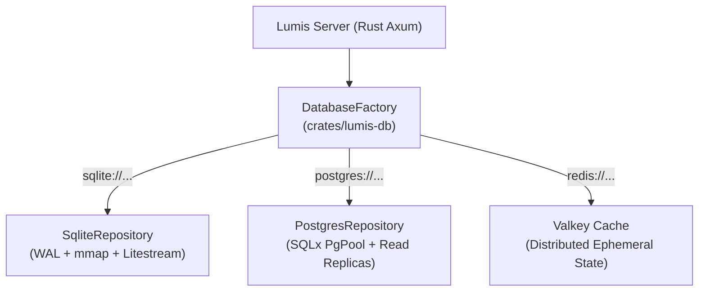

# 💾 Phase 2: Pluggable Multi-Database & High Availability

Fase ini menjamin ketersediaan tinggi (*High Availability*), replikasi basis data multi-region, dan kebebasan migrasi tanpa terkunci pada satu mesin database.

---

## 🎯 Sasaran Utama

1. **Abstraksi Repository Interface-First (DIP & SOLID)**:
   - Seluruh logika bisnis berkomunikasi melalui trait `ChatRepository`.
   - Perpindahan mesin database (SQLite -> PostgreSQL) dilakukan murni melalui konfigurasi `DATABASE_URL` tanpa perubahan kode.
2. **PostgreSQL Enterprise Clustering**:
   - Skalabilitas baca via read-replicas dan connection pooler (PgBouncer/SQLx PgPool).
   - Mendukung multi-node deployment dengan transaksi konkuren tingkat tinggi.
3. **SQLite WAL & Edge Storage**:
   - Mode Write-Ahead Logging (WAL) dan memory-mapped I/O (`PRAGMA mmap_size = 268435456`).
   - Replikasi kontinu ke S3/MinIO via Litestream untuk deployment standalone/edge tanpa kehilangan data (RPO < 1s).
4. **Valkey / Redis Distributed State**:
   - Caching sesi ephemeral dan token bucket rate limiting antar node Lumis.

---

## 📐 Arsitektur Database Pluggable

---

## 📦 Komponen & Implementasi Terverifikasi

1. [x] [`lumis_core::traits::ChatRepository`](file:///root/projects/lumis/crates/lumis-core/src/traits/repository.rs): Kontrak async trait untuk seluruh operasi database.
2. [x] [`lumis_db::SqliteRepository`](file:///root/projects/lumis/crates/lumis-db/src/sqlite/mod.rs): Implementasi SQLite dengan composite index cursor pagination.
3. [x] [`lumis_db::PostgresRepository`](file:///root/projects/lumis/crates/lumis-db/src/postgres/mod.rs): Implementasi PostgreSQL berbasis SQLx PgPool.
4. [x] [`lumis_db::DatabaseFactory`](file:///root/projects/lumis/crates/lumis-db/src/factory.rs): Factory pattern penentu driver database dinamis.
5. [x] [`tests/sqlite_test.rs`](file:///root/projects/lumis/crates/lumis-db/tests/sqlite_test.rs): Gauntlet pengujian siklus hidup repositori SQLite & pagination.

---

## 🧪 Kriteria Keberhasilan & Gauntlet

- [x] Pergantian database dari SQLite ke PostgreSQL berjalan transparan melalui `DATABASE_URL`.
- [x] Keyset pagination `(created_at, id) < (cursor_time, cursor_id)` berjalan dalam $\mathcal{O}(\log N)$ index seek.
- [x] Zero data corruption saat simulasi failover atau restart server mendadak.
- [x] 100% berkas berukuran `< 350 lines` dan lulus verifikasi `cargo test`.
