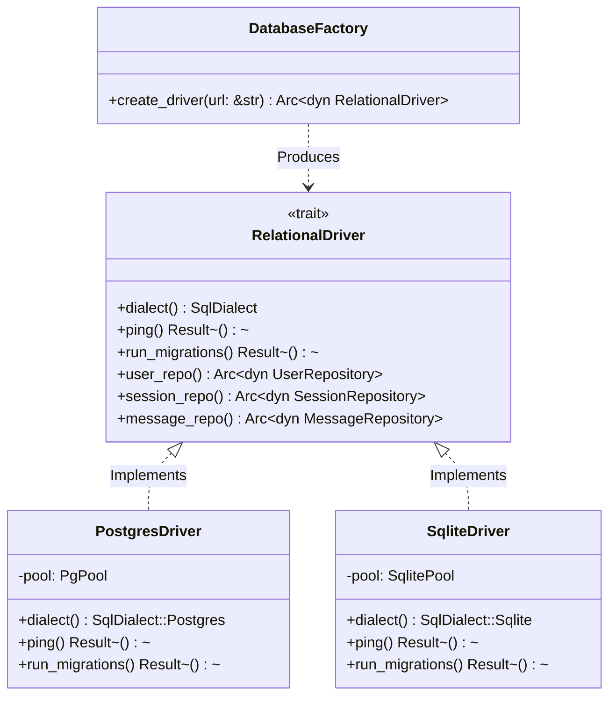

# 💾 Phase 2: Relational Driver Pattern & High Availability

Fase ini mengimplementasikan **Relational Driver Pattern** (pola *EIP Channel Adapter*), memastikan persistensi data Lumis sepenuhnya **agnostik terhadap database relasional** tanpa penguncian vendor (*zero lock-in*), mendukung standar **ANSI SQL**, dan menjamin ketersediaan tinggi (*High Availability*).

---

## 🎯 Sasaran Utama & Standar Enterprise

1. **Relational Driver Pattern (EIP Channel Adapter)**:
   - Abstraksi kontrak murni yang memisahkan logika aplikasi dari dialek SQL spesifik (`$1` pada Postgres vs `?` pada SQLite).
   - Penanganan otomatis perbedaan tipe data (JSONB vs TEXT, TIMESTAMPTZ vs RFC3339 TEXT).
2. **PostgreSQL Enterprise Clustering**:
   - Skalabilitas baca/tulis melalui klaster PostgreSQL dan connection pooler enterprise (PgBouncer / SQLx PgPool).
   - Dukungan transaksi ACID aman dan multi-node concurrency.
3. **SQLite WAL & Edge Zero-Ops Storage**:
   - Mode Write-Ahead Logging (WAL) dan memory-mapped I/O (`PRAGMA mmap_size = 268435456`) untuk performa baca/tulis sub-milidetik.
   - Ideal untuk deployment lokal, isolated air-gapped container, atau edge server.
4. **Keyset (Cursor-Based) Pagination $\mathcal{O}(\log N)$**:
   - Menggantikan pagination lambat `OFFSET K` yang $\mathcal{O}(K)$ scan leaf B-Tree dengan composite tuple seek `WHERE (created_at, id) < (cursor_time, cursor_id)`.
   - Latensi query tetap stabil <0.1ms meskipun tabel chat memiliki jutaan rekaman.
5. **Self-Bootstrapping Schema Migration**:
   - Eksekusi migrasi skema tabel otomatis saat startup tanpa mewajibkan perkakas CLI eksternal, memastikan pengalaman *zero friction* saat pertama kali deploy.

---

## 📐 Arsitektur Relational Driver Pattern

---

## 📦 Komponen & Target Luaran

1. `lumis_core::traits::driver`: Kontrak trait `RelationalDriver`, `SqlDialect`, dan repositori domain.
2. `lumis_db::postgres::driver`: Implementasi driver PostgreSQL dengan pooling PgPool.
3. `lumis_db::sqlite::driver`: Implementasi driver SQLite WAL dengan memory mmap.
4. `lumis_db::factory`: EIP Factory penentu driver dinamis berbasis scheme URL (`postgres://` atau `sqlite://`).
5. `tests/relational_driver_test.rs`: Gauntlet pengujian integritas transaksi, driver switching, dan keyset pagination.
