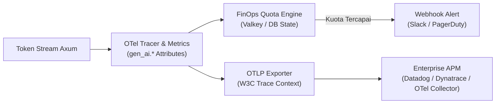

# 💰 Phase 4: OpenTelemetry GenAI & AI FinOps Budgeting

Fase ini melengkapi Lumis dengan observabilitas telemetri standar terbuka **OpenTelemetry (OTel) GenAI Semantic Conventions (`gen_ai.*`)** serta tata kelola finansial (*AI FinOps*) untuk pemantauan biaya token real-time.

---

## 🎯 Sasaran Utama & Standar Enterprise 2026

1. **OpenTelemetry GenAI Semantic Conventions (`gen_ai.*`)**:
   - Standardisasi atribut observabilitas vendor-neutral:
     - `gen_ai.provider.name` (openai, anthropic, deepseek, vllm).
     - `gen_ai.operation.name` (`chat`, `embeddings`).
     - `gen_ai.request.model` & `gen_ai.response.model`.
     - `gen_ai.usage.input_tokens` & `gen_ai.usage.output_tokens`.
   - Instrumen metrik standar OTel:
     - `gen_ai.client.token.usage` (Histogram konsumsi token per role/tenant).
     - `gen_ai.client.operation.duration` (Histogram latensi respons per provider).
2. **W3C Distributed Tracing (`traceparent`, `tracestate`)**:
   - Propagasi trace context lintas layanan backend enterprise tanpa memutus jejak panggilan (*trace lineage*).
3. **Privasi & Keamanan Konten (Privacy-First Telemetry)**:
   - Sesuai standar OTel GenAI 2026 dan regulasi UU PDP / GDPR: teks mentah prompt dan jawaban **tidak dicatat ke span secara default** (hanya metadata token dan durasi). Perekaman teks hanya aktif via *explicit opt-in event* di environment non-produksi.
4. **Penegakan Kuota Token Granular & FinOps Alerting**:
   - Batas kuota berjenjang per tenant dan peran pengguna.
   - Ekspor metrik via OTLP gRPC/HTTP dan endpoint `/metrics` Prometheus.

---

## 📐 Arsitektur Observabilitas & FinOps

---

## 📦 Komponen & Implementasi Terverifikasi

1. [x] [`lumis_core::traits::TokenQuotaEngine`](file:///root/projects/lumis/crates/lumis-core/src/traits/finops.rs) & [`TelemetryCollector`](file:///root/projects/lumis/crates/lumis-core/src/traits/finops.rs): Kontrak interface FinOps token budget dan OpenTelemetry semantic collector.
2. [x] [`lumis_server::finops::InMemoryQuotaEngine`](file:///root/projects/lumis/crates/lumis-server/src/finops/quota_engine.rs): Enforcer sliding-window token quota berjenjang per role (SuperAdmin 10M, TenantAdmin 1M, PowerUser 200k, Member 50k, Guest 5k) dengan penolakan HTTP 429 Too Many Requests dan header `Retry-After`.
3. [x] [`lumis_server::finops::PrometheusTelemetryCollector`](file:///root/projects/lumis/crates/lumis-server/src/finops/telemetry.rs): Pengumpul metrik OTel GenAI (`gen_ai_client_token_usage_total`, `gen_ai_client_operation_duration_ms_total`).
4. [x] [`lumis_server::routes::metrics`](file:///root/projects/lumis/crates/lumis-server/src/routes/metrics.rs): Endpoint scraper Prometheus `GET /metrics` dan `GET /api/finops/summary`.
5. [x] [`tests/otel_finops_test.rs`](file:///root/projects/lumis/crates/lumis-server/tests/otel_finops_test.rs): Gauntlet pengujian kuota token HTTP 429 dan kepatuhan Prometheus.

---

## 🧪 Kriteria Keberhasilan & Gauntlet

- [x] Penegakan kuota token otomatis menghentikan request berlebih dengan respons HTTP 429 dan header `Retry-After`.
- [x] Endpoint `GET /metrics` menghasilkan metrik berstandar OpenTelemetry GenAI 2026.
- [x] 100% berkas berukuran `< 350 lines` dan diverifikasi dengan `detect-mocks .` serta `cargo test --workspace`.
