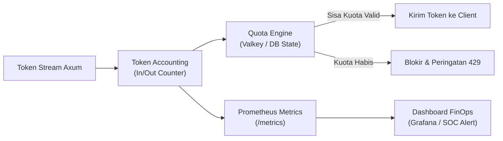

# 💰 Phase 4: FinOps, Token Budgeting & Telemetry

Fase ini menghadirkan tata kelola finansial kecerdasan artifisial (*AI FinOps*), penegakan kuota token per divisi/pegawai, dan observabilitas real-time via Prometheus.

---

## 🎯 Sasaran Utama

1. **Penegakan Kuota Token Granular**:
   - Batas kuota harian/bulanan berdasarkan hierarki peran (`guest`: 10k token, `member`: 100k token, `power_user`: 1M token, `admin`: tak terbatas).
   - Penghentian otomatis jika batas kuota tercapai dengan respon informatif `429 Too Many Requests`.
2. **Kalkulasi Biaya Multi-Penyedia (Multi-Provider Cost Engine)**:
   - Pencatatan konsumsi token input & output secara real-time.
   - Perhitungan estimasi biaya per divisi/satker dalam mata uang lokal (IDR/USD).
3. **Observabilitas Prometheus & Alerting**:
   - Endpoint `/metrics` standar Prometheus (metrik: `lumis_tokens_consumed_total`, `lumis_active_streams`, `lumis_request_duration_seconds`).
   - Integrasi webhook alert ke Slack/Telegram/Discord saat penggunaan token divisi mencapai 80% dan 100%.

---

## 📐 Arsitektur FinOps & Observabilitas

---

## 📦 Komponen & Target Luaran

1. `lumis_core::models::quota`: Kontrak kuota token dan konfigurasi batas pengguna.
2. `lumis_server::middleware::quota`: Interceptor penghitung token dan penegak kuota sebelum permintaan dieksekusi.
3. `lumis_server::routes::metrics`: Endpoint scraper Prometheus.
4. `tests/quota_test.rs`: Pengujian throttler kuota dan akurasi kalkulator biaya.

---

## 🧪 Kriteria Keberhasilan & Gauntlet

- [ ] Pengguna yang melebihi batas kuota harian otomatis dibatasi tanpa memengaruhi pengguna lain di departemen yang sama.
- [ ] Metrik konsumsi token tercatat presisi 100% tanpa ada token yang hilang saat streaming terputus.
- [ ] 100% berkas berukuran `< 350 lines` dan lulus verifikasi `cargo test`.
