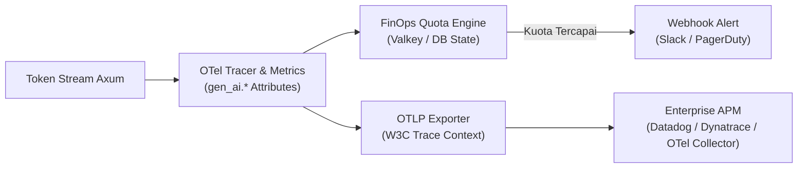

# 💰 Phase 4: OpenTelemetry GenAI & AI FinOps Budgeting

Fase ini melengkapi Lumis dengan observabilitas telemetri standar terbuka **OpenTelemetry (OTel) GenAI Semantic Conventions (`gen_ai.*`)** serta tata kelola finansial (*AI FinOps*) untuk pemantauan biaya token real-time.

---

## 🎯 Sasaran Utama & Standar Enterprise 2026

1. **OpenTelemetry GenAI Semantic Conventions (`gen_ai.*`)**:
   - Standardisasi atribut observabilitas vendor-neutral:
     - `gen_ai.provider.name` (openai, anthropic, deepseek, vllm).
     - `gen_ai.operation.name` (`chat`, `embeddings`).
     - `gen_ai.request.model` & `gen_ai.response.model`.
     - `gen_ai.usage.input_tokens` & `gen_ai.usage.output_tokens`.
   - Instrumen metrik standar OTel:
     - `gen_ai.client.token.usage` (Histogram konsumsi token per role/tenant).
     - `gen_ai.client.operation.duration` (Histogram latensi respons per provider).
2. **W3C Distributed Tracing (`traceparent`, `tracestate`)**:
   - Propagasi trace context lintas layanan backend enterprise tanpa memutus jejak panggilan (*trace lineage*).
3. **Privasi & Keamanan Konten (Privacy-First Telemetry)**:
   - Sesuai standar OTel GenAI 2026 dan regulasi UU PDP / GDPR: teks mentah prompt dan jawaban **tidak dicatat ke span secara default** (hanya metadata token dan durasi). Perekaman teks hanya aktif via *explicit opt-in event* di environment non-produksi.
4. **Penegakan Kuota Token Granular & FinOps Alerting**:
   - Batas kuota berjenjang per tenant dan peran pengguna.
   - Ekspor metrik via OTLP gRPC/HTTP dan endpoint `/metrics` Prometheus.

---

## 📐 Arsitektur Observabilitas & FinOps

---

## 📦 Komponen & Target Luaran

1. `lumis_server::telemetry::otel`: Inisialisasi OpenTelemetry tracer dan meter provider dengan konvensi `gen_ai.*`.
2. `lumis_server::middleware::quota`: Interceptor kuota token dan pencatat metrik histogram.
3. `lumis_server::routes::metrics`: Endpoint scraper Prometheus.
4. `tests/otel_finops_test.rs`: Pengujian kepatuhan atribut `gen_ai.*` dan pembatasan kuota 429.
