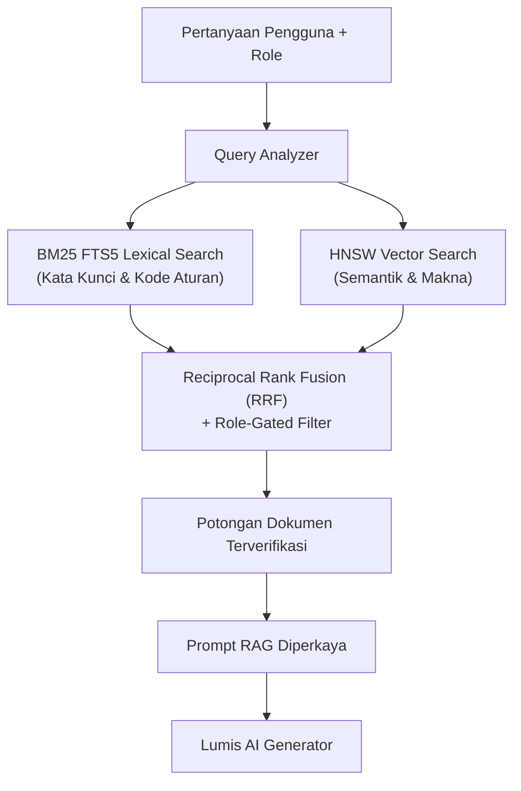

# 📚 Phase 5: Enterprise Knowledge Vault & Hybrid RAG

Fase ini mengintegrasikan repositori pengetahuan institusional terisolasi (*Enterprise Knowledge Vault*) menggunakan pendekatan **Hybrid RAG** (pencarian leksikal BM25 + pencarian semantik vektor HNSW) dengan isolasi berbasis peran (*Role-Gated Retrieval*).

---

## 🎯 Sasaran Utama

1. **Pencarian Hibrida Tingkat Tinggi (Hybrid RAG)**:
   - Kombinasi **BM25 Lexical Inverted Index** (pencarian kata kunci eksak, kode aturan, nomor SK) dan **Dense Vector Embeddings** (pencarian pemahaman makna kontekstual).
   - Reciprocal Rank Fusion (RRF) untuk penggabungan skor relevansi terbaik.
2. **Role-Gated Document Access (Isolasi Hak Akses)**:
   - Setiap dokumen terindeks membawa label klirens minimal (`super_admin`, `tenant_admin`, `member`, `guest`).
   - Hasil pencarian difilter otomatis pada tingkat query database sesuai peran pengguna aktif; dokumen rahasia pimpinan tidak akan pernah bocor ke staf reguler.
3. **Pipeline Ingesti Multi-Format**:
   - Ekstraksi teks dari dokumen PDF, Office (DOCX/XLSX), Markdown, dan data tabular terstruktur.
   - Chunking adaptif berbasis semantik paragraf dengan preservasi hierarki judul.

---

## 📐 Arsitektur Hybrid RAG Terisolasi

---

## 📦 Komponen & Target Luaran

1. `lumis_core::traits::knowledge`: Abstraksi trait penyimpanan dan pengambilan pengetahuan (`KnowledgeVault`).
2. `lumis_db::rag`: Driver pencarian hibrida terintegrasi dengan SQLite FTS5 / PostgreSQL `pgvector`.
3. `lumis_server::routes::rag`: Endpoint upload dokumen dan query RAG.
4. `tests/rag_test.rs`: Pengujian filter keamanan isolasi peran dan akurasi peringkat dokumen.

---

## 🧪 Kriteria Keberhasilan & Gauntlet

- [ ] Pengguna `guest` tidak dapat melihat dokumen dengan label klirens `member` atau `admin`.
- [ ] Latensi pencarian hibrida <50ms untuk korpus 100.000 potongan teks.
- [ ] 100% berkas berukuran `< 350 lines` dan lulus verifikasi `cargo test`.
