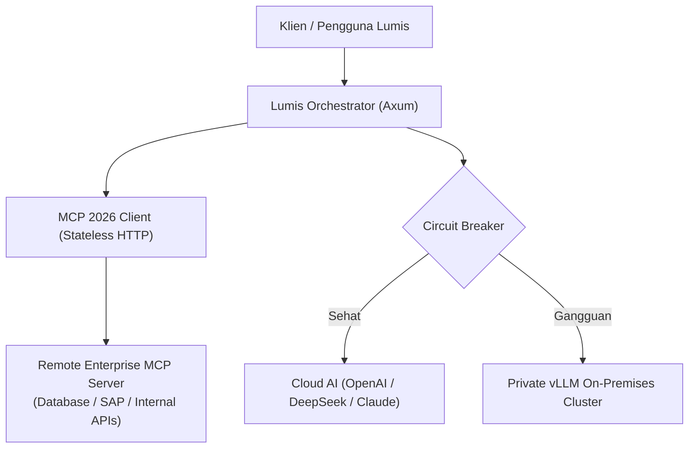

# 🔀 Phase 6: Model Context Protocol (MCP 2026) & SLA Failover

Fase ini mengintegrasikan ekosistem agen cerdas berstandar **Model Context Protocol (MCP 2026 - AAIF / Linux Foundation)**, perutean multi-penyedia dinamis, dan ketahanan *circuit breaker* dengan *auto-failover* ke model internal (*private vLLM/Ollama*).

---

## 🎯 Sasaran Utama & Standar MCP 2026

1. **Stateless Remote MCP Protocol (Streamable HTTP / SSE)**:
   - Mengimplementasikan spesifikasi MCP 2026 berbasis protokol stateless HTTP/SSE.
   - Kompatibel penuh dengan reverse proxy enterprise dan Kubernetes Load Balancer tanpa ketergantungan sticky session.
2. **Enterprise Managed Authorization (EMA)**:
   - Integrasi IdP OAuth 2.0 / OIDC ketat dengan **Issuer Validation (RFC 9207)** dan Client Identifier Metadata Documents (CIMD).
   - Penegakan izin granular: tool eksekusi diverifikasi terhadap peran pengguna (`EnterpriseRole`).
3. **Ekstensi Tugas Asinkron (Tasks Extension)**:
   - Standarisasi eksekusi tool berdurasi panjang (query data berat, kompilasi kode) via async tasks dengan *durable status handles* dan polling non-blocking.
4. **Interactive MCP Apps**:
   - Kemampuan server MCP mengirimkan komponen UI interaktif (tabel data, grafik, formulir konfirmasi) langsung ke antarmuka Svelte 5 Lumis.
5. **Multi-Model SLA Failover & Circuit Breaker**:
   - Transisi otomatis: `Closed` -> `Open` -> `Half-Open` saat terjadi lonjakan latensi atau error 5xx dari cloud LLM.
   - Failover sub-300ms ke klaster internal private vLLM saat API eksternal terputus.

---

## 📐 Arsitektur MCP 2026 & Failover

---

## 📦 Komponen & Target Luaran

1. `lumis_core::models::mcp` & `lumis_core::traits::mcp`: Abstraksi trait dan model MCP 2026 (EMA, Tool Definition, Tasks Extension).
2. `lumis_server::mcp::registry`: Mesin registri MCP in-memory dan eksekutor tugas asinkron.
3. `lumis_server::routes::mcp`: Endpoint stateless HTTP `tools/list`, `tools/call`, `tasks`, dan `tasks/{task_id}`.
4. `lumis_server::llm::resilient_router`: Mesin circuit breaker dan failover multi-provider.
5. `tests/mcp_test.rs` & `tests/resilient_llm_and_telemetry_test.rs`: Pengujian koneksi MCP 2026, isolasi EMA, tugas asinkron, dan simulasi failover.

---

## 🧪 Kriteria Keberhasilan & Gauntlet

- [x] **Enterprise Managed Authorization (EMA)**: Tool dengan klirens tinggi (`TenantAdmin`) otomatis disaring dan ditolak saat dipanggil oleh `Member` atau `Guest` (Terverifikasi empiris pada `tests/mcp_test.rs`).
- [x] **MCP 2026 Asynchronous Tasks Extension**: Lifecycle pembuatan task, polling status durabel (`running` -> `completed`), dan pembatalan task berjalan non-blocking (Terverifikasi empiris pada `tests/mcp_test.rs`).
- [x] **Multi-Provider SLA Failover**: Otomatis berpindah dari upstream cloud yang mengalami gangguan (503/429/timeout) ke upstream cadangan on-premises vLLM (Terverifikasi empiris pada `tests/resilient_llm_and_telemetry_test.rs`).
- [x] **Adversarial Fault Injection & Sentinel Verification**: Terbukti menolak simulasi pemadaman downstream secara eksplisit tanpa mengembalikan mock data palsu (Terverifikasi empiris pada `tests/adversarial_fault_injection_test.rs`).
- [x] **100% Berkas < 350 Baris & Zero-Mock Compliance**: Seluruh berkas (115 berkas) lolos pengecekan deterministik line limits dan lolos audit `detect-mocks .`.
