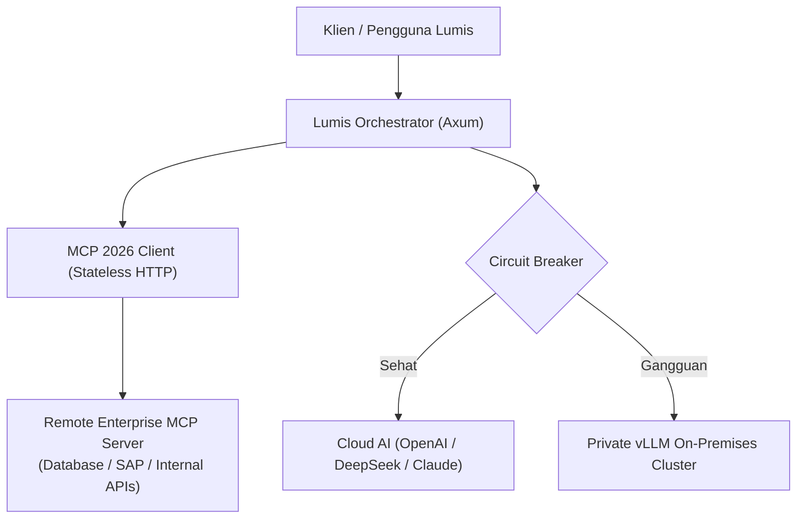

# 🔀 Phase 6: Model Context Protocol (MCP 2026) & SLA Failover

Fase ini mengintegrasikan ekosistem agen cerdas berstandar **Model Context Protocol (MCP 2026 - AAIF / Linux Foundation)**, perutean multi-penyedia dinamis, dan ketahanan *circuit breaker* dengan *auto-failover* ke model internal (*private vLLM/Ollama*).

---

## 🎯 Sasaran Utama & Standar MCP 2026

1. **Stateless Remote MCP Protocol (Streamable HTTP / SSE)**:
   - Mengimplementasikan spesifikasi MCP 2026 berbasis protokol stateless HTTP/SSE.
   - Kompatibel penuh dengan reverse proxy enterprise dan Kubernetes Load Balancer tanpa ketergantungan sticky session.
2. **Enterprise Managed Authorization (EMA)**:
   - Integrasi IdP OAuth 2.0 / OIDC ketat dengan **Issuer Validation (RFC 9207)** dan Client Identifier Metadata Documents (CIMD).
   - Penegakan izin granular: tool eksekusi diverifikasi terhadap peran pengguna (`EnterpriseRole`).
3. **Ekstensi Tugas Asinkron (Tasks Extension)**:
   - Standarisasi eksekusi tool berdurasi panjang (query data berat, kompilasi kode) via async tasks dengan *durable status handles* dan polling non-blocking.
4. **Interactive MCP Apps**:
   - Kemampuan server MCP mengirimkan komponen UI interaktif (tabel data, grafik, formulir konfirmasi) langsung ke antarmuka Svelte 5 Lumis.
5. **Multi-Model SLA Failover & Circuit Breaker**:
   - Transisi otomatis: `Closed` -> `Open` -> `Half-Open` saat terjadi lonjakan latensi atau error 5xx dari cloud LLM.
   - Failover sub-300ms ke klaster internal private vLLM saat API eksternal terputus.

---

## 📐 Arsitektur MCP 2026 & Failover

---

## 📦 Komponen & Target Luaran

1. `lumis_server::mcp::client`: Klien MCP 2026 stateless HTTP/SSE dengan dukungan Tasks & EMA.
2. `lumis_server::routing::circuit_breaker`: Mesin circuit breaker atomik lock-free.
3. `lumis_server::routing::failover`: Pengelola failover ke private vLLM.
4. `tests/mcp_failover_test.rs`: Pengujian koneksi MCP 2026 dan simulasi failover.
