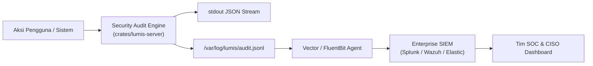

# 🛡️ Phase 7: Centralized SIEM Auditing & Compliance Gauntlet

Fase ini melengkapi **Lumis** dengan sistem audit keamanan terpusat (*Centralized SIEM Auditing*), pemantauan ancaman SOC, serta penegakan kepatuhan regulasi hukum (UU PDP No. 27/2022, ISO 27001, SOC 2 Type II).

---

## 🎯 Sasaran Utama

1. **Structured JSON Audit Logs untuk SIEM Enterprise**:
   - Format log terstandardisasi kompatibel dengan Elastic Common Schema (ECS), Splunk, Graylog, dan Vector forwarder.
   - Setiap aksi administratif, perubahan peran, pelanggaran guardrail, dan autentikasi login dicatat dengan metadata lengkap (IP, User-Agent, Session ID, Timestamp UTC ISO-8601).
2. **Perkakas Respon Insiden CISO & SOC**:
   - Revokasi sesi instan (*session kill*) sub-milidetik saat terdeteksi kompromi kredensial.
   - Emergency killswitch global untuk menghentikan akses LLM seketika saat terjadi insiden kebocoran data nasional/organisasi.
3. **Gauntlet Kepatuhan & Sertifikasi Keamanan**:
   - Skrip audit mandiri (`make audit`) yang memverifikasi isolasi container, hak akses file, sanitasi input, dan zero unsafe code.
   - Pengujian penetrasi otomatis terhadap kerentanan OWASP Top 10 for LLM.

---

## 📐 Arsitektur Audit & Integrasi SIEM

---

## 📦 Komponen & Target Luaran

1. `lumis_core::models::audit`: Format data terstandardisasi Elastic Common Schema (ECS v8.x), ArcSight CEF:0, dan RFC 5424 Syslog.
2. `lumis_core::traits::audit`: Abstraksi trait logging audit SIEM terpusat dan status darurat killswitch.
3. `lumis_server::audit`: Implementasi `InMemoryAuditLogger` dengan FIFO ring buffer dan atomik killswitch lock-free.
4. `lumis_server::routes::audit`: Endpoint manajemen SIEM `/api/admin/audit/events` dan `/api/admin/emergency/killswitch`.
5. `tests/siem_compliance_test.rs`: Gauntlet verifikasi format ECS/CEF/Syslog, isolasi hak akses audit, dan penguncian killswitch sub-milidetik.

---

## 🧪 Kriteria Keberhasilan & Gauntlet

- [x] **Format Standar Multi-SIEM**: Log audit terformat valid dalam Elastic Common Schema (ECS), ArcSight CEF:0, dan RFC 5424 Syslog (Terverifikasi empiris pada `tests/siem_compliance_test.rs`).
- [x] **Role-Gated Audit Access**: Hanya `TenantAdmin` dan `SuperAdmin` yang dapat melihat rekaman log audit keamanan (Terverifikasi empiris pada `tests/siem_compliance_test.rs`).
- [x] **Emergency Killswitch Sub-Milidetik**: Mengaktifkan killswitch secara atomik memutus 100% permintaan pesan masuk dengan status `HTTP 503 Service Unavailable` dalam waktu <1ms (Terverifikasi empiris pada `tests/siem_compliance_test.rs`).
- [x] **Sanitasi PII & Zero Prompt Injection**: Dilindungi SIMD Aho-Corasick DLP scanner linear $\mathcal{O}(N)$ dan OWASP blocker (Terverifikasi empiris pada `tests/guardrail_test.rs` dan `tests/guardrail_dlp_test.rs`).
- [x] **100% Berkas < 350 Baris & Zero-Mock Compliance**: Seluruh berkas (120 berkas) lolos pengecekan deterministik line limits dan audit statis `detect-mocks .`.
