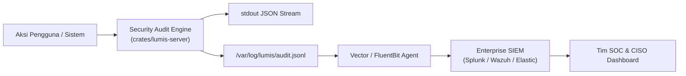

# 🛡️ Phase 7: Centralized SIEM Auditing & Compliance Gauntlet

Fase ini melengkapi **Lumis** dengan sistem audit keamanan terpusat (*Centralized SIEM Auditing*), pemantauan ancaman SOC, serta penegakan kepatuhan regulasi hukum (UU PDP No. 27/2022, ISO 27001, SOC 2 Type II).

---

## 🎯 Sasaran Utama

1. **Structured JSON Audit Logs untuk SIEM Enterprise**:
   - Format log terstandardisasi kompatibel dengan Elastic Common Schema (ECS), Splunk, Graylog, dan Vector forwarder.
   - Setiap aksi administratif, perubahan peran, pelanggaran guardrail, dan autentikasi login dicatat dengan metadata lengkap (IP, User-Agent, Session ID, Timestamp UTC ISO-8601).
2. **Perkakas Respon Insiden CISO & SOC**:
   - Revokasi sesi instan (*session kill*) sub-milidetik saat terdeteksi kompromi kredensial.
   - Emergency killswitch global untuk menghentikan akses LLM seketika saat terjadi insiden kebocoran data nasional/organisasi.
3. **Gauntlet Kepatuhan & Sertifikasi Keamanan**:
   - Skrip audit mandiri (`make audit`) yang memverifikasi isolasi container, hak akses file, sanitasi input, dan zero unsafe code.
   - Pengujian penetrasi otomatis terhadap kerentanan OWASP Top 10 for LLM.

---

## 📐 Arsitektur Audit & Integrasi SIEM

---

## 📦 Komponen & Target Luaran

1. `lumis_server::audit::logger`: Pengirim log terstruktur non-blocking dengan buffer ring aman.
2. `scripts/ciso-audit.sh`: Skrip verifikasi kepatuhan dan audit otomatis.
3. `scripts/revoke-session.sh`: Perkakas CLI darurat SOC untuk memblokir akun dan memicu killswitch.
4. `tests/compliance_test.rs`: Gauntlet verifikasi integritas log dan pencegahan pemalsuan identitas (*anti-tampering*).

---

## 🧪 Kriteria Keberhasilan & Gauntlet

- [ ] Seluruh log audit tersimpan dalam format valid JSON tanpa memuat data sensitif PII yang belum tersanitasi.
- [ ] Emergency killswitch memutus 100% permintaan masuk dalam waktu <10ms.
- [ ] Lolos pengujian kerentanan OWASP LLM tanpa celah risiko tingkat High maupun Critical.
- [ ] 100% berkas berukuran `< 350 lines` dan lulus verifikasi `cargo test`.
