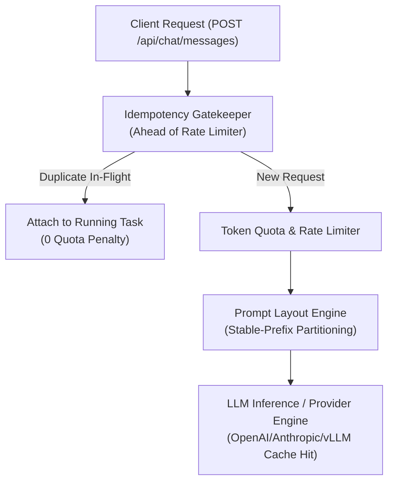

# 🚀 Phase 8: High-Performance Prompt Prefix Caching, Catalog ETag & Start-Generation Idempotency

Dokumen ini mendefinisikan arsitektur dan implementasi teknis untuk **Fase 8** dari platform enterprise Lumis. Fase ini dirancang untuk mengatasi inefisiensi kritis yang ditemukan pada sistem generasi sebelumnya (seperti yang dilaporkan pada isu riil `LibreChat#16877`, `LibreChat#14349`, dan `LibreChat#15757`).

---

## 🎯 Sasaran Arsitektural

1. **Stable-Prefix Prompt Cache Engine (Anti-Invalidation)**:
   - Memastikan byte sequence awal (system instructions + MCP tool definitions) 100% identik (*byte-invariant*) antar percakapan dan giliran (*turns*).
   - Menghilangkan degradasi performa di mana timestamp dinamis disuntikkan ke awal/tengah system prompt sehingga membatalkan *KV cache* pada OpenAI, Anthropic, Gemini, dan vLLM RadixAttention.
   - Mengalokasikan variabel dinamis dan temporal (seperti waktu pencarian web) secara deterministik ke *tail dynamic context* (ekor konteks) setelah riwayat pesan.

2. **Start-Generation Idempotency Middleware (Ahead of Rate-Limiter & Quota)**:
   - Mencegah *double-billing* token dan penalti *false 429 Too Many Requests* saat pengguna melakukan *double-click* atau saat koneksi HTTP klien melakukan *retry* otomatis.
   - Dedup token/kunci idempotensi dijalankan *sebelum* middleware pembatas laju dan pengurangan kuota.
   - Jika request identik sedang berjalan (*in-flight*), request kedua otomatis melampirkan (*attach*) diri ke aliran SSE yang sama tanpa memotong kuota baru.

3. **MCP Catalog ETag & Invalidation Firewall**:
   - Memasukkan header `ETag` dan `If-None-Match` berbasis nomor revisi katalog MCP atomik (`McpCatalogRevision`).
   - Mencegah refetch querying `/api/mcp/tools` yang membebani server pada setiap pesan yang dikirim klien (menyelesaikan *regression* `LibreChat#15757`).

---

## 🏛️ Desain Modul & Trait

### 1. `crates/lumis-core/src/models/prompt_cache.rs`
- Struct `PromptLayout`:
  - `system_prompt: String`
  - `tool_definitions_json: String`
  - `history_messages: Vec<ChatMessage>`
  - `tail_dynamic_context: Option<String>`
- Method:
  - `stable_prefix_hash() -> String`: Menghitung SHA-256 dari `system_prompt + tool_definitions_json`.
  - `format_anthropic_payload() -> Value`: Menyisipkan breakpoint `cache_control: {"type": "ephemeral"}` pada akhir blok stabil.

### 2. `crates/lumis-core/src/traits/idempotency.rs`
- Trait `IdempotencyStore`:
  - `claim(&self, key: &str, user_id: &str) -> Result<IdempotencyState, LumisError>`
  - `complete(&self, key: &str, response_payload: &str) -> Result<(), LumisError>`

---

## 🧪 Rencana Verifikasi Empiris (Gauntlet)

- [x] `test_prompt_layout_stable_prefix_invariance`: Memverifikasi SHA-256 hash dari prefix stabil tidak berubah meskipun konteks dinamis/timestamp berubah pada ekor request (Terverifikasi di `tests/prompt_cache_and_idempotency_test.rs`).
- [x] `test_idempotency_ahead_of_quota_deduction`: Memverifikasi pemanggilan berulang dengan kunci idempotensi yang sama tidak mengurangi token quota ganda dan tidak memicu 429 (Terverifikasi di `tests/prompt_cache_and_idempotency_test.rs`).
- [x] `test_mcp_catalog_etag_and_304_cache`: Memverifikasi `/api/mcp/tools` mengembalikan `304 Not Modified` saat `If-None-Match` sesuai dengan revisi katalog saat ini (Terverifikasi di `tests/prompt_cache_and_idempotency_test.rs`).
