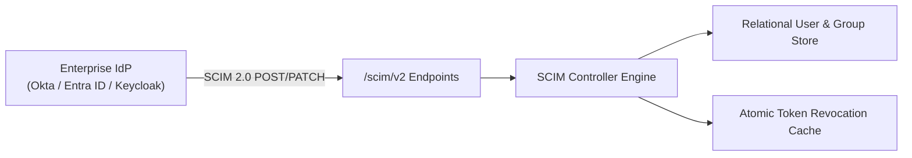

# 🏢 Phase 9: SCIM 2.0 Identity Governance & Automated Group Provisioning

Dokumen ini mendefinisikan arsitektur dan spesifikasi teknis untuk **Fase 9** platform Lumis, yang mengimplementasikan protokol **System for Cross-domain Identity Management (SCIM 2.0)** (RFC 7643 dan RFC 7644) untuk tata kelola identitas enterprise tanpa friksi (*zero friction lifecycle management*).

---

## 🎯 Sasaran Arsitektural

1. **Automated User Lifecycle Management (RFC 7644)**:
   - Endpoint resmi SCIM 2.0: `/scim/v2/Users` (`GET`, `POST`, `PUT`, `PATCH`, `DELETE`).
   - Menerima provisi otomatis dari Okta, Microsoft Entra ID (Azure AD), PingFederate, dan Keycloak.
   - De-provisi deterministik: saat karyawan *offboarding* atau dinonaktifkan (`active: false`), seluruh token JWT aktif dicabut secara instan dan akses ditolak oleh PEP pada sub-milidetik.

2. **Automated Group & Role Synchronization**:
   - Endpoint SCIM 2.0: `/scim/v2/Groups` (`GET`, `POST`, `PATCH`, `DELETE`).
   - Sinkronisasi anggota grup direktori enterprise ke hierarki peran internal Lumis (`EnterpriseRole`: `SuperAdmin`, `TenantAdmin`, `PowerUser`, `Member`, `Guest`).
   - Mencegah inkonsistensi hak akses yang lazim terjadi pada arsitektur berbasis token statis.

3. **Standard SCIM Error Formatting**:
   - Mengembalikan respon error dengan skema `urn:ietf:params:scim:api:messages:2.0:Error` untuk kepatuhan penuh terhadap klien IDaaS enterprise.

---

## 🏛️ Desain Modul & Trait

### 1. `crates/lumis-core/src/models/scim.rs`
- Struct `ScimUser`:
  - `schemas: Vec<String>` (`urn:ietf:params:scim:schemas:core:2.0:User`)
  - `id: String`
  - `user_name: String`
  - `active: bool`
  - `roles: Vec<String>`
- Struct `ScimGroup`:
  - `id: String`
  - `display_name: String`
  - `members: Vec<ScimGroupMember>`

### 2. `crates/lumis-core/src/traits/scim.rs`
- Trait `ScimProvisioner`:
  - `create_user(&self, user: ScimUser) -> Result<ScimUser, LumisError>`
  - `update_user_status(&self, user_id: &str, active: bool) -> Result<(), LumisError>`
  - `sync_group_membership(&self, group_id: &str, members: &[String]) -> Result<(), LumisError>`

---

## 🧪 Bukti Verifikasi Empiris (Gauntlet)

- [x] `test_scim_user_and_group_lifecycle_rfc7644`: Provisi pengguna SCIM, pembaruan status de-provisi (`active: false`), provisi grup, penghapusan, dan respon error standar RFC 7644 (Terverifikasi di `tests/scim_and_approval_test.rs`).
