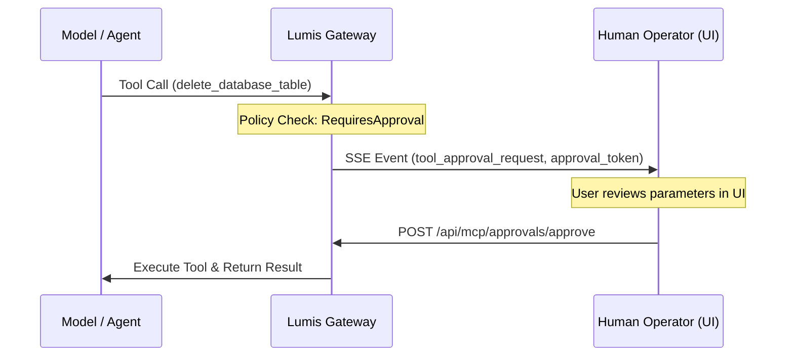

# 🛡️ Phase 10: Human-in-the-Loop Tool Approval Policies & Safe Execution

Dokumen ini mendefinisikan arsitektur teknis untuk **Fase 10** platform Lumis, yang mengimplementasikan kebijakan persetujuan eksekusi tool (*Human-in-the-Loop Approval Policies*) untuk mencegah eksekusi aksi berisiko tinggi tanpa pengawasan manusia (merujuk pada kebutuhan enterprise pada `LibreChat#14193`).

---

## 🎯 Sasaran Arsitektural

1. **Granular Tool Approval Policies**:
   - Mendefinisikan mode eksekusi untuk setiap MCP Tool:
     - `AutoApproved`: Tool baca atau fungsi tanpa efek samping (e.g. kalkulator, pencarian vektor).
     - `RequiresApproval`: Tool dengan efek samping permanen (e.g. modifikasi basis data, eksekusi shell, pembayaran, pengiriman email).
     - `RestrictedToRole`: Hanya dapat dijalankan langsung oleh pengguna dengan peran tertentu (e.g. `SuperAdmin`), sedangkan peran lain memerlukan persetujuan supervisor.

2. **Non-Blocking Approval Workflow**:
   - Ketika model memutuskan untuk memanggil tool yang membutuhkan persetujuan, Lumis tidak menghentikan sesi atau me-revert state percakapan.
   - Server mengeluarkan event SSE `tool_approval_request` yang membawa token persetujuan kriptografis (`approval_token`) dan ringkasan parameter aksi.
   - Pengguna atau administrator dapat menyetujui (`POST /api/mcp/approvals/{token}/approve`) atau menolak (`POST /api/mcp/approvals/{token}/deny`).
   - Setelah keputusan diterima, task yang sedang ditangguhkan (*suspended task*) melanjutkan eksekusi secara mulus.

3. **Cryptographic Proof & Audit Trail**:
   - Setiap keputusan persetujuan ditandatangani dan dicatat ke dalam audit trail SIEM (Phase 7) dengan identitas approver dan stempel waktu UTC.

---

## 🏛️ Desain Modul & Trait

### 1. `crates/lumis-core/src/models/approval.rs`
- Enum `ToolApprovalPolicy`:
  - `AutoApproved`
  - `RequiresApproval`
  - `Restricted(EnterpriseRole)`
- Struct `ToolApprovalRequest`:
  - `approval_token: String`
  - `tool_name: String`
  - `parameters: serde_json::Value`
  - `requested_by: String`
  - `expires_at: i64`
