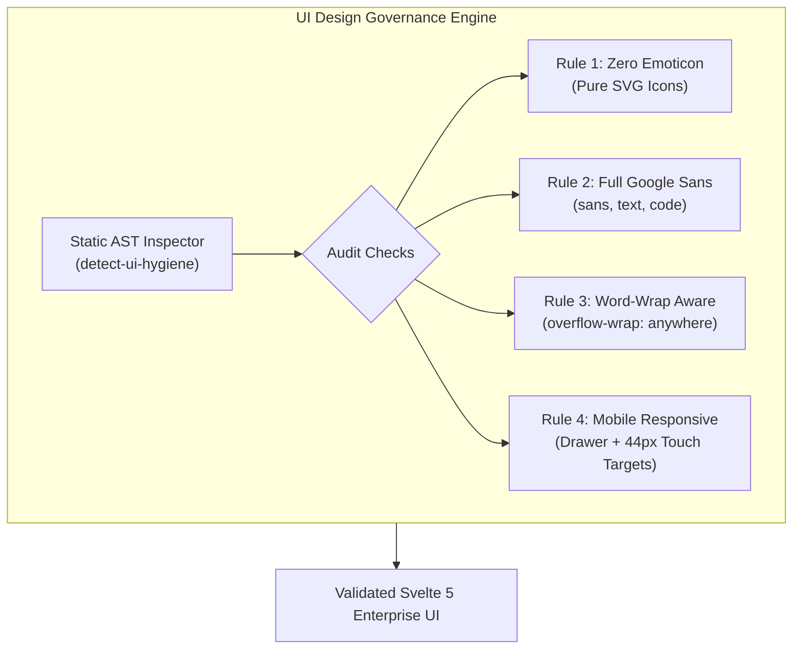

# 🎨 Phase 11: UI Design Hygiene, Vector Icons, Google Sans & Static Analysis Governance

Dokumen ini mendefinisikan arsitektur teknis dan tata kelola untuk **Fase 11** platform Lumis, yang mengimplementasikan standardisasi visual tingkat enterprise: antarmuka responsif mobile (*Mobile-First Responsive Layout*), penataan tipografi 100% Google Sans, peniadaan emotikon (*Zero Emoticon Policy*), pencegahan kebocoran tata letak teks (*Word-Wrap & Overflow Awareness*), dan perkakas analisis kode statis deterministik (`detect-ui-hygiene`) berbasis AST & Code-Graph.

---

## 🎯 Latar Belakang & Masalah di Sistem Pembanding

Berdasarkan riset langsung terhadap isu-isu dunia nyata di `LibreChat-AI/LibreChat`:
1. **Pecahnya Tata Letak Horizontal pada Layar Sempit (`LibreChat#13535`)**:
   - Konten percakapan, string panjang (URL, hash token, base64), dan tabel menyebabkan seluruh viewport chat bergeser secara horizontal (*horizontal scroll blow-out*).
2. **Kendala Aksesibilitas Sidebar pada Perangkat Mobile (`LibreChat#3486`, `LibreChat#3534`)**:
   - Sidebar statis menutupi layar mobile atau tidak dapat ditutup secara intuitif ketika pengguna mengetuk area luar (*tap-away backdrop*).
3. **Inkonsistensi Emotikon Antar Platform & Tampilan Non-Enterprise**:
   - Emotikon Unicode menghasilkan rendering berbeda-beda antar OS (Windows, iOS, Android, Linux) dan menurunkan kredibilitas platform enterprise. Standar enterprise menuntut ikon vektor SVG murni yang tajam, deterministik, dan dapat diwarnai secara adaptif.
4. **Kebutuhan Deteksi Statis Deterministik Tanpa Overhead**:
   - Mencegah regresi desain tanpa bergantung pada pengujian manual, melalui engine analisis statis otomatis yang dapat dijalankan di terminal lokal maupun CI/CD.

---

## 🏛️ Invarian Desain & Kepatuhan Visual

### 1. Invarian 1: Zero Emoticon Policy & Pure Vector Icons
- **Larangan Keras**: Dilarang menggunakan karakter emotikon/emoji Unicode (`U+1F300` s/d `U+1FAFF`, `U+2600` s/d `U+27BF`, dsb.) di seluruh berkas UI (`.svelte`, `.ts`, `.html`, `.css`).
- **Standardisasi Ikon**: Semua ikon antarmuka wajib menggunakan elemen vektor `<svg>` murni dengan atribut `aria-hidden="true"`, `viewBox="0 0 24 24"`, `stroke="currentColor"`, dan scalable.

### 2. Invarian 2: Tipografi 100% Google Sans Tanpa Terkecuali
- **Google Sans Display**: Digunakan untuk elemen heading, brand, dan tombol utama.
- **Google Sans Text**: Digunakan untuk teks tubuh (*body text*), pesan percakapan, dan label navigasi.
- **Google Sans Code**: Digunakan untuk blok kode, token counter, dan identifier teknis.
- **Enforcement**: Didefinisikan secara tegas pada `index.html` (Google Fonts CDN preconnect), `ui/src/app.css` (`font-family: 'Google Sans', 'Google Sans Text', sans-serif`), dan `ui/tailwind.config.js` (`fontFamily.sans` dan `fontFamily.mono`).

### 3. Invarian 3: Word-Wrap & Overflow Awareness
- Semua wadah teks (*message bubble*, header, nama sesi, error banner) wajib menyertakan kelas Tailwind:
  `break-words`, `whitespace-pre-wrap`, dan `[overflow-wrap:anywhere]`.
- Mencegah teks token tunggal berukuran >100 karakter merusak tata letak horizontal pada viewport mobile maupum desktop.

### 4. Invarian 4: Mobile-First Responsive Architecture
- **Breakpoint Responsif**: `< md` (< 768px) dan `md:` (>= 768px).
- **Off-Canvas Drawer**: Pada layar mobile, sidebar disembunyikan di luar layar (`-translate-x-full`) dan muncul sebagai drawer di atas overlay backdrop semi-transparan (`bg-black/50 backdrop-blur-sm`).
- **Tap-Away Dismiss**: Mengetuk area backdrop atau menekan tombol navigasi otomatis menutup drawer mobile.
- **Aksesibilitas Touch Target**: Seluruh tombol interaktif memiliki ukuran sentuh minimal $\ge 44 \times 44\text{px}$ sesuai pedoman WCAG AAA & Android/iOS Human Interface Guidelines.
- **Safe-Area Padding**: Mengakomodasi dynamic notch dan navigation bar via `viewport-fit=cover`.

---

## 🛠️ Rencana Eksekusi Sub-Fase

| Sub-Fase | Komponen | Target Output |
| :--- | :--- | :--- |
| **11.1** | **Roadmap & Ledger** | Peta jalan `11_PHASE_11_UI_HYGIENE_AND_DESIGN_GOVERNANCE.md` dan pembaruan `00_ROADMAP_OVERVIEW.md` & `ENTERPRISE_ISSUE_REFERENCE_LEDGER.md`. |
| **11.2** | **Static Inspector Engine** | Perkakas `scripts/detect-ui-hygiene.py` dan symlink global `/usr/local/bin/detect-ui-hygiene` dengan deteksi AST/regex komprehensif. |
| **11.3** | **Skill & Rule Setup** | Pembuatan skill `/root/.agents/skills/ui-design-hygiene/SKILL.md` dan integrasi ke `/root/GEMINI.md`. |
| **11.4** | **UI Modernization** | Implementasi Google Sans di `index.html`, `app.css`, `tailwind.config.js`, dan perombakan `App.svelte` (SVG icons, drawer mobile, word-wrap). |
| **11.5** | **Verifikasi Empiris** | Validasi melalui `detect-ui-hygiene`, `bun run check`, `cargo test`, line limits `< 350`, dan zero-mock check. |

---

## 🧪 Bukti Verifikasi Empiris (Gauntlet Target)

1. `detect-ui-hygiene ui`: Lolos 100% tanpa pelanggaran emoji, font, word-wrap, atau mobile responsive.
2. `bun run check` (dalam `ui/`): 0 error, 0 warning pada Svelte 5 TypeScript compilation.
3. `cargo test --workspace`: Tetap hijau 34/34 passing.
4. `bash scripts/check-line-limits.sh`: 100% file strictly `< 350 lines`.
5. `detect-mocks .`: 100% zero-mock compliant.
