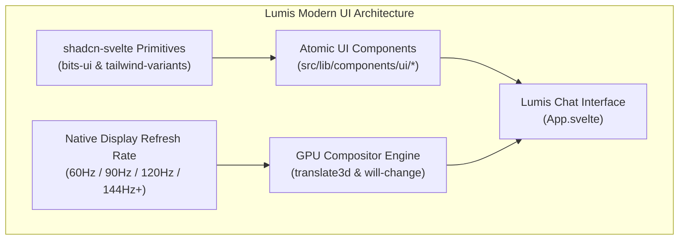

# ⚡ Phase 12: shadcn-svelte Standard Components & Native Refresh Rate Display Engine

Dokumen ini mendefinisikan arsitektur teknis dan panduan implementasi untuk **Fase 12** platform Lumis, yang mengadopsi standarisasi komponen antarmuka resmi **shadcn-svelte** (https://www.shadcn-svelte.com/) dan engine animasi GPU-composited yang sinkron dengan kecepatan refresh layar asli (*Native Display Refresh Rate: 60Hz, 90Hz, 120Hz ProMotion, hingga 144Hz+ Gaming Displays*).

---

## 🎯 Rasionalisasi Arsitektural

### 1. Efisiensi Token & Kerapian Kode via shadcn-svelte
- **Masalah**: Menulis komponen UI (tombol, lencana, input, drawer, modal, separator) dari nol (*from scratch*) berulang kali memboroskan token LLM, meningkatkan potensi regresi visual, dan menyulitkan pemeliharaan jangka panjang.
- **Solusi**: Menggunakan pola kanonikal **shadcn-svelte**:
  - Konfigurasi `components.json` resmi.
  - Helper utilitas `cn()` (`clsx` + `tailwind-merge`).
  - Primitive composable components dari `bits-ui` dan `tailwind-variants`.
  - Iconography resmi `lucide-svelte` (vektor SVG murni tanpa emotikon).
  - Registry komponen modular di `src/lib/components/ui/` (`button`, `badge`, `textarea`, `separator`, `card`, `scroll-area`).

### 2. Animasi Setinggi Refresh Rate Layar Asli (60Hz / 90Hz / 120Hz / 144Hz+)
- **Masalah Reflow & Layout Jank (`LibreChat#11058`)**:
  - Menggerakkan properti geometri kotak CSS seperti `width`, `height`, `top`, `left`, `margin`, atau `padding` memaksa CPU menjalankan *layout recalculation* dan *repaint* di setiap frame pada thread JavaScript utama. Hal ini menimbulkan *frame-drops* (stuttering) dan membuat animasi terasa kaku pada perangkat dengan layar 120Hz/144Hz (misalnya smartphone flagship, iPad Pro, atau monitor gaming).
- **Solusi GPU Compositing Layer**:
  - **Zero-Reflow Compositor Invariant**: Animasi HANYA menggunakan properti *compositor-only*: `transform` (GPU translation) dan `opacity`.
  - **Promosi GPU Hardware Layer**: Penggunaan `transform: translate3d(0, 0, 0)` atau `transform: translateZ(0)` untuk memisahkan elemen yang bergerak ke GPU Texture terpisah.
  - **CSS `will-change: transform, opacity`**: Memberi tahu browser rendering engine (WebKit, Blink, Gecko) untuk menyiapkan alokasi memori VRAM GPU sebelum transisi dimulai.
  - **Kurva Easing 120fps Ergonomis**: `cubic-bezier(0.16, 1, 0.3, 1)` untuk menghasilkan perlambatan pegas alami yang mulus setara 120fps.
  - **Smooth Momentum Scrolling**: `-webkit-overflow-scrolling: touch` dan `overscroll-behavior: contain`.

---

## 🏛️ Invarian Kepatuhan & Arsitektur

### 1. Invarian 1: shadcn-svelte Standard Component Registry
- Seluruh elemen interaktif dasar (tombol aksi, lencana peran/model, wadah teks) wajib memanfaatkan komponen dari `src/lib/components/ui/` yang berbasis `cn()` dan `tailwind-variants`.
- Standar penataan warna mengadopsi variabel semantik CSS HSL (`--background`, `--foreground`, `--primary`, `--muted`, `--border`, dll.).

### 2. Invarian 2: Hardware-Accelerated 120Hz/144Hz Native Animation
- Dilarang menganimasikan `width`, `height`, `left`, `right`, `top`, `bottom` pada drawer sidebar maupun dialog.
- Transisi drawer dan overlay WAJIB menggunakan:
  - `transform-gpu` / `translate-x-*` / `-translate-x-full`
  - `will-change: transform`
  - `backface-visibility: hidden`

---

## 🛠️ Rencana Eksekusi Sub-Fase

| Sub-Fase | Komponen | Target Output |
| :--- | :--- | :--- |
| **12.1** | **Roadmap & Ledger** | Peta jalan Fase 12 dan pembaruan `00_ROADMAP_OVERVIEW.md` & `ENTERPRISE_ISSUE_REFERENCE_LEDGER.md`. |
| **12.2** | **Skill & Static Linter Update** | Penyesuaian `ui-design-hygiene` skill dan aturan `detect-ui-hygiene` (`RULE_SHADCN_COMPLIANCE`, `RULE_HIGH_REFRESH_RATE_ANIMATION`). |
| **12.3** | **shadcn-svelte Registry Setup** | `components.json`, `src/lib/utils.ts` (`cn`), CSS variables di `app.css`, tema di `tailwind.config.js`. |
| **12.4** | **Atomic UI Components** | Implementasi `Button`, `Badge`, `Textarea`, `Separator`, `Card` sesuai spesifikasi shadcn-svelte untuk Svelte 5. |
| **12.5** | **App.svelte Refactoring & 120Hz GPU Tuning** | Migrasi ke shadcn components, Lucide icons, dan hardware-accelerated drawer transitions. |
| **12.6** | **Empirical Gauntlet Verification** | Pengujian `detect-ui-hygiene`, `bun run check`, `bun run build`, `cargo test`, line limits `< 350`, dan zero-mock check. |

---

## 🧪 Bukti Verifikasi Empiris (Gauntlet Target)

1. `detect-ui-hygiene ui`: 100% PASS (memvalidasi kepatuhan shadcn-svelte dan animasi GPU 120Hz).
2. `bun run check`: 0 error, 0 warning pada kompilasi Svelte 5 + bits-ui + lucide-svelte.
3. `bun run build`: Berhasil mengompilasi bundel statis teroptimasi.
4. `cargo test --workspace`: Tetap hijau 34/34 passing.
5. `bash scripts/check-line-limits.sh`: 100% file strictly `< 350 lines`.
6. `detect-mocks .`: 100% zero-mock compliant.
