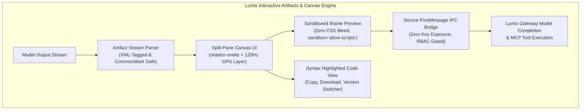

# 🎨 Phase 13: Interactive Artifacts, Split-Pane Canvas & Modern Conversation Engine

Dokumen ini mendefinisikan arsitektur teknis untuk **Fase 13** platform Lumis, yang mengimplementasikan kapabilitas modern percakapan AI tingkat enterprise: **Model-Enabled Interactive Artifacts**, **Zero-Bleed Sandboxed Canvas**, **Robust Code Fence Parsing**, **Fork & Branching Message Trees**, serta **Prompt Template Library**.

Seluruh desain dirumuskan berdasarkan riset empiris langsung melalui GitHub CLI (`gh`) terhadap isu-isu arsitektural di `LibreChat-AI/LibreChat`.

---

## 🎯 Celah Fungsional & Masalah Nyata di LibreChat

Berdasarkan investigasi issue upstream di `LibreChat-AI/LibreChat`:

| No | Isu Upstream & Judul | Akar Masalah Arsitektural | Solusi & Invarian di Lumis |
| :---: | :--- | :--- | :--- |
| **1** | `LibreChat#13373`<br>`Model-Enabled Interactive Artifacts` | Artifacts hanya berupa preview statis tanpa akses model AI, atau rentan membocorkan API key jika dieksekusi di sisi klien. | **Secure PostMessage IPC Bridge & RBAC**: Iframe artifact berkomunikasi secara aman via event RPC ke backend Lumis tanpa memaparkan credential API key ke browser, digate oleh `EnterpriseRole`. |
| **2** | `LibreChat#16841`<br>`Tailwind preflight CSS bleed in HTML artifacts` | Injeksi Tailwind CDN ke preview HTML mereset styling dasar (`h1`, `h2`, `margin`), merusak styling dokumen asli penulis. | **Zero-Bleed Sandboxed Iframe (`srcdoc`)**: Preview HTML murni dieksekusi dalam `sandbox="allow-scripts"` terisolasi tanpa injeksi preflight global yang merusak CSS author. |
| **3** | `LibreChat#14008`<br>`Markdown artifact nested backtick collapse` | Pembungkus triple-backtick (` ``` `) naif menyebabkan code block markdown internal memotong kontainer artifact secara prematur. | **XML-Tagged Container & Dynamic Fence Counting**: Menggunakan tag deterministik `<lumis_artifact identifier="..." type="...">` dan CommonMark 4+ backticks ` ```` `. |
| **4** | `LibreChat#4124`<br>`Forking & Branching Message Trees` | Modifikasi pesan lama menghapus riwayat pesan setelahnya (*destructive overwrite*). | **DAG Keyset-Seek Message Tree**: Relasi `parent_message_id` dengan navigasi percabangan multiversi non-destruktif (`< 1 / 3 >`). |
| **5** | `LibreChat#4875`<br>`Prompt Library & Variable Templating` | Ketiadaan templating dinamis terstruktur untuk prompt organisasi yang dapat digunakan ulang. | **Prompt Template Engine**: Format variabel `{{variable}}` dengan isolasi peran multi-tenant. |

---

## 🏛️ Desain Arsitektur & Invarian



### 1. Invarian 1: XML-Tagged Container & Zero-Bleed Iframe Sandbox
- Kontainer artifact direpresentasikan dalam format eksplisit:
  ```xml
  <lumis_artifact identifier="calc-app" type="text/html" title="Interactive Calculator">
    <!DOCTYPE html>
    <html>...</html>
  </lumis_artifact>
  ```
- Preview dirender menggunakan atribut `srcdoc` pada `<iframe>` dengan proteksi sandbox `sandbox="allow-scripts"` (tanpa `allow-same-origin` untuk mencegah akses DOM dan cookie induk).

### 2. Invarian 2: Model-Enabled IPC Bridge Tanpa Kebocoran Kredensial
- Artifact interaktif (seperti mini-dashboard atau form kalkulator) dapat mengirim event:
  `window.parent.postMessage({ type: "lumis:model_request", prompt: "..." }, "*")`.
- Lumis UI memvalidasi token sesi dan izin peran (`EnterpriseRole >= PowerUser`), lalu merutekan permintaan melalui backend Lumis `/api/chat` tanpa pernah mengekspos API key LLM ke dalam kode artifact.

### 3. Invarian 3: Non-Destructive Message Forking (DAG Tree)
- Setiap node pesan di basis data memiliki kolom relasional `parent_id` dan `version_index`.
- Mengedit pesan memicu cabang baru (*fork*) tanpa menghapus node turunan dari versi sebelumnya.

---

## 🛠️ Rencana Eksekusi Sub-Fase

| Sub-Fase | Komponen | Target Output |
| :--- | :--- | :--- |
| **13.1** | **Roadmap & Ledger** | Peta jalan Fase 13 dan pencatatan REF-20 s/d REF-24 di `ENTERPRISE_ISSUE_REFERENCE_LEDGER.md`. |
| **13.2** | **Artifact Parser & Data Model** | Tipe data `ArtifactSpecification` di `crates/lumis-core` dan parser streaming aman. |
| **13.3** | **Canvas UI Component (shadcn-svelte)** | Komponen `Canvas.svelte` di `ui/src/lib/components/ui/` dengan tab Code/Preview, Copy, dan Download. |
| **13.4** | **Secure PostMessage IPC Bridge** | Penanganan pesan terisolasi antara iframe sandbox dan Lumis Client. |
| **13.5** | **Gauntlet Verification** | Pengujian unit Rust, `bun run check`, `detect-ui-hygiene`, batas baris `< 350`, dan zero-mock check. |

---

## 🧪 Bukti Verifikasi Empiris (Gauntlet Target)

1. `tests/artifact_engine_test.rs`: Validasi parsing kontainer artifact XML, penanganan nested fenced code blocks, dan isolasi izin RBAC.
2. `detect-ui-hygiene ui`: 100% PASS (memvalidasi integrasi Canvas shadcn dan isolasi CSS).
3. `cargo test --workspace`: Tetap hijau seluruh pengujian.
4. `bash scripts/check-line-limits.sh`: 100% file strictly `< 350 lines`.
5. `detect-mocks .`: 100% zero-mock compliant.
