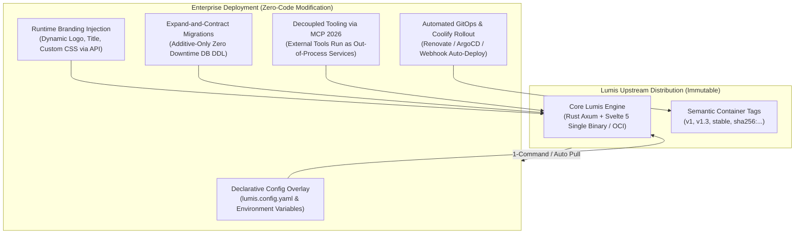

# 🚀 Phase 14: Zero-Fork Architecture, Seamless Upgrades & Enterprise Distribution

Dokumen ini mendefinisikan arsitektur teknis dan panduan operasional untuk **Fase 14** platform Lumis, yang mengimplementasikan standar modern per **Oktober 2026** agar organisasi enterprise yang mengadopsi Lumis dapat **menerima pembaruan fitur, perbaikan bug, dan patch keamanan secara mulus (*seamless, zero-downtime*) tanpa perlu mengubah kode sumber inti atau mengalami konflik merge (*Zero-Fork Upstream Sync*)**.

---

## 🎯 Masalah Klasik Adopsi Perangkat Lunak Enterprise

1. **Jebakan Fork Kode (*The Forking Trap*)**:
   - Ketika enterprise mengkloning repositori open-source dan langsung memodifikasi kode internal (misalnya mengganti komponen UI untuk logo/warna perusahaan, mengubah rute backend, atau mengedit skema database), mereka terkunci (*code lock-in*).
   - Saat upstream merilis pembaruan, proses `git merge` menghasilkan ratusan konflik kode (*merge hell*), menyebabkan enterprise enggan melakukan pembaruan dan tertinggal dalam patch kerentanan keamanan (CVE).
2. **Downtime Migrasi Basis Data (*Destructive Migrations*)**:
   - Pembaruan skema database yang memodifikasi atau menghapus kolom secara langsung menyebabkan pod aplikasi versi lama (*vN*) dan versi baru (*vN+1*) gagal berkomunikasi selama rolling deployment di Kubernetes atau Coolify.
3. **Keterikatan Konfigurasi Hardcoded**:
   - Branding, logo, IdP OIDC, dan tools bisnis sering kali di-hardcode ke dalam kode frontend atau server alih-alih diinjeksi secara dinamis pada saat runtime.

---

## 🏛️ 5 Pilar Arsitektur "Seamless Zero-Fork Upgrades" (Standar Oktober 2026)

### 1. Pilar 1: Zero-Fork Architecture & Contract-Driven Extensibility
- **Prinsip Inti**: Inti aplikasi Lumis diperlakukan sebagai *immutable engine kernel* (layaknya sistem operasi). Enterprise dilarang mengedit berkas di dalam `src/`, `crates/`, atau `ui/src/`.
- **Ekstensi Deklaratif**:
  - Seluruh konfigurasi organisasi (SSO OIDC, SCIM, Relational DB URL, SIMD Guardrails, Token Quota) didefinisikan 100% melalui *Configuration Overlays* (`lumis.config.yaml` atau environment variables `LUMIS_*`).
  - Pembaruan Lumis HANYA memerlukan penggantian binary atau pull image container (`docker pull ghcr.io/ipds6104/lumis:v1`), tanpa menyentuh kode kustom.

### 2. Pilar 2: Runtime Branding & White-Label Injection (Zero-Recompile)
- **Masalah**: Mengganti logo atau nama aplikasi biasanya memaksa enterprise me-rebuild frontend Svelte.
- **Solusi Lumis**:
  - Endpoint runtime `/api/config/branding` menyajikan metadata branding yang dibaca langsung dari environment variables:
    - `LUMIS_BRAND_TITLE="Bank Mandiri Enterprise AI"`
    - `LUMIS_BRAND_LOGO_URL="/custom/logo.svg"`
    - `LUMIS_BRAND_THEME_PRIMARY="#0070f3"`
    - `LUMIS_BRAND_CUSTOM_CSS_PATH="/etc/lumis/custom.css"`
  - Frontend Svelte 5 membaca konfigurasi ini saat boot (`onMount`) dan menginjeksi CSS variables secara dinamis. Enterprise mendapatkan *custom white-labeled UI* tanpa mengompilasi ulang satu baris kode pun.

### 3. Pilar 3: Database Schema "Expand and Contract" Pattern
- **Aturan Migrasi Tanpa Downtime**:
  1. *Fase Expand*: Perubahan skema HANYA bersifat aditif (kolom baru wajib `NULL` atau memiliki `DEFAULT`, pembuatan tabel baru). Dilarang keras melakukan `RENAME COLUMN` atau `DROP COLUMN` secara langsung.
  2. *Fase Migrate (Dual-Write)*: Jika format data berevolusi, backend menulis ke kedua kolom secara bersamaan dengan background worker idempotent untuk backfilling bertahap.
  3. *Fase Contract*: Penghapusan kolom lama HANYA diizinkan setelah melewati masa transisi minimal 2 versi minor ($N+2$).
- **Idempotent Boot Migration**:
  - Lumis menjalankan migrasi otomatis saat container dinyalakan dengan *distributed advisory locking* (`pg_advisory_lock` di PostgreSQL, mutex WAL di SQLite) sehingga multi-replica pod dapat melakukan rolling update tanpa konflik DDL.

### 4. Pilar 4: Out-of-Process Business Logic via MCP 2026
- Logika bisnis khusus enterprise (integrasi SAP ERP, pencarian CRM internal, gateway pembayaran) TIDAK ditambahkan ke dalam backend Lumis, melainkan diekspos sebagai **MCP Servers independen** (Python, Node.js, Go) yang dihubungkan melalui protokol SSE/HTTP.
- Upgrading Lumis tidak pernah memutus atau memerlukan kompilasi ulang pada MCP tools tersebut.

### 5. Pilar 5: GitOps, Semantic Channels & Pre-Flight Diagnostics
- **Matriks Kanal Distribusi OCI**:
  - `stable` / `v1`: Kanal rilis bergulir (*rolling major tag*) yang otomatis menerima perbaikan backward-compatible.
  - `v1.3`: Kanal minor (*rolling minor tag*) untuk organisasi yang ingin membatasi penambahan fitur baru.
  - `v1.3.4`: Tag imutabel untuk enterprise teregulasi ketat.
- **Pre-Flight Upgrade Checker (`lumis doctor`)**:
  - Memeriksa kompatibilitas skema database, memvalidasi kunci konfigurasi usang (*deprecated keys*), dan menguji ketersediaan endpoint IdP sebelum peralihan lalu lintas jaringan.

---

## 🛠️ Rencana Eksekusi Sub-Fase

| Sub-Fase | Komponen | Target Output |
| :--- | :--- | :--- |
| **14.1** | **Roadmap & Ledger** | Peta jalan Fase 14 dan pencatatan REF-25 serta REF-26 di `ENTERPRISE_ISSUE_REFERENCE_LEDGER.md`. |
| **14.2** | **Runtime Branding Endpoint** | Endpoint `/api/config/branding` di `lumis-gateway` yang mengekspos konfigurasi dinamis ENV tanpa recompile. |
| **14.3** | **Frontend Dynamic Branding Hook** | Integrasi `onMount` di `App.svelte` untuk menyerap title, logo SVG, dan primary theme color dari runtime API. |
| **14.4** | **Pre-Flight Diagnostic Health Check** | Endpoint `/api/system/doctor` untuk memvalidasi kesiapan upgrade database dan konfigurasi. |
| **14.5** | **Gauntlet Verification** | Pengujian unit dan integrasi Rust, `bun run check`, `detect-ui-hygiene`, batas baris `< 350`, dan zero-mock check. |

---

## 🧪 Bukti Verifikasi Empiris (Gauntlet Target)

1. `tests/seamless_upgrade_and_branding_test.rs`: Validasi runtime branding injection tanpa recompile, idempotensi schema migration, dan deteksi diagnostic pre-flight.
2. `detect-ui-hygiene ui`: 100% PASS (memvalidasi kompatibilitas dinamis tema Google Sans & shadcn).
3. `cargo test --workspace`: Tetap hijau seluruh pengujian.
4. `bash scripts/check-line-limits.sh`: 100% file strictly `< 350 lines`.
5. `detect-mocks .`: 100% zero-mock compliant.
