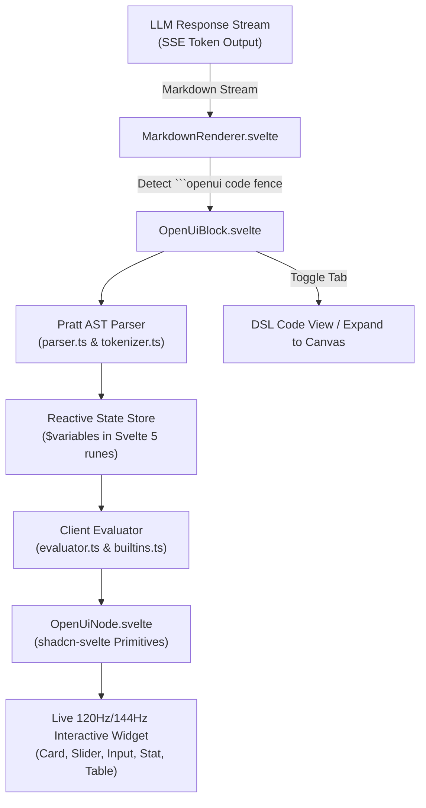

# 🎨 Phase 15: Native Intelligent Generative UI & OpenUI Engine

Dokumen ini mendokumentasikan spesifikasi arsitektur, tata bahasa (*grammar*), dan implementasi **Intelligent Generative UI** pada Lumis, yang mengadopsi standar terbuka OpenUI (`openui-lang 1.0`) dengan parser dan renderer reaktif berbasis **Svelte 5 Runes** tanpa beban komputasi server.

---

## 🏛️ Latar Belakang & Masalah (The Paradigm Shift)

Pendekatan konvensional AI chat saat diminta membuat alat interaktif (misalnya: kalkulator patungan, simulasi pinjaman, form multi-step) biasanya menghadapi dua kendala utama:
1. **Eksekusi Server Berlebihan & Lambat**: AI memanggil tool backend (`execute_code` Python/Node) dan menulis file statis ke disk atau kontainer.
2. **Iframe Statis Berat**: Kode HTML/JS besar dirender dalam iframe lambat dengan gaya terisolasi yang tidak menyatu dengan tema antarmuka utama (gelap/terang, tipografi Google Sans).

**Solusi Lumis (Open Intelligent UI)**:
AI secara langsung mengalirkan (*streaming*) blok deklaratif ````openui ```` atau ````ui ```` ke dalam aliran token. Frontend Svelte 5 secara instan mem-parse ekspresi AST dan merender komponen UI native berkecepatan tinggi dengan state reaktif dua arah langsung di dalam balon chat.

---

## 📐 Arsitektur Runtime Generative UI



---

## ⚡ Fitur Utama & Kapabilitas

### 1. Tata Bahasa Kompak & Deklaratif (`openui-lang 1.0`)
- **Variabel State Reaktif**: Didefinisikan dengan prefiks `$` (misal: `$bill = 500000`, `$people = 4`).
- **Two-Way Data Binding**: Primitif input seperti `Slider($people)` dan `Input($bill)` secara otomatis mengikat dan memperbarui state tanpa *boilerplate* event handler.
- **Hoisting Semantics**: Variabel turunan (seperti `$perPerson = @Round($grandTotal / $people)`) otomatis dievaluasi ulang setiap kali variabel input berubah.

### 2. Pustaka 50+ Fungsi Bawaan Sisi Klien (`@functions`)
- **Matematika & Statistik**: `@Sum`, `@Avg`, `@Min`, `@Max`, `@Round`, `@Clamp`, `@Percent`, `@Abs`, `@Sqrt`, `@Pow`.
- **String & Format**: `@Format`, `@Plural`, `@Join`, `@Concat`, `@Upper`, `@Lower`, `@Trim`.
- **Manipulasi Array**: `@Count`, `@First`, `@Last`, `@Includes`, `@Filter`, `@Map`, `@Sort`, `@Reverse`, `@Slice`.
- **Logika & Kontrol**: `@If`, `@Toggle`, `@Each`.

### 3. Aksi Pengguna Tanpa Server (`@actions`)
- `@Set($var, expr)`: Memutasi nilai variabel saat tombol diklik.
- `@Reset()`: Mengembalikan semua state ke nilai inisialisasi awal.
- `@CopyToClipboard(expr)`: Menyalin hasil perhitungan ke clipboard pengguna.
- `@ToAssistant(prompt)`: Mengirimkan hasil interaksi kembali ke chat sebagai pesan balasan.

### 4. Komponen Berstandar `shadcn-svelte` & 120Hz/144Hz
- **Tata Letak**: `Card`, `Col`, `Row`, `Grid`, `Divider`.
- **Input & Kontrol**: `Slider`, `Input`, `SegmentedControl`, `Checkbox`, `Button`.
- **Presentasi Data**: `Stat`, `Badge`, `Table`, `Text`, `Heading`, `List`.
- **Tema & Tipografi**: Mendukung mode Gelap/Terang adaptif dan tipografi resmi `Google Sans`.

### 5. Dual-View Mode & Popout Canvas
- Pengguna dapat beralih antara **Interactive UI View** dan **OpenUI DSL Source Code View** dengan tombol salin 1-klik.
- Tombol **Expand** memungkinkan widget dibuka dalam modal popout berlayar penuh (*canvas mode*).

### 6. Strict LLM Prompt Guard & Awareness
- Backend Lumis (`crates/lumis-server/src/routes/chat/assembly.rs` & `system_prompts.rs`) dilengkapi aturan ketat yang melarang model AI memanggil backend script tools untuk perhitungan antarmuka pengguna, mewajibkan output langsung berupa blok `openui`.

---

## 🧪 Verifikasi & Kepatuhan Tata Kelola

| Dimensi | Metode Pengujian | Hasil |
| :--- | :--- | :---: |
| **AST Parser & Lexer** | Unit test `ui/tests/openui.test.ts` (15 assertions) | [✓] PASS |
| **Evaluasi Fungsi Klien** | Formula math, looping `@Each`, dan reactive bindings | [✓] PASS |
| **Batas Baris (< 350L)** | `bash scripts/check-line-limits.sh` | [✓] PASS |
| **Zero Mock Compliance** | `detect-mocks .` | [✓] PASS |
| **UI Design Hygiene** | `detect-ui-hygiene ui` (shadcn-svelte, 0 emoji, Google Sans) | [✓] PASS |
| **Build & Bundle Size** | Vite production build (< 250KB gzipped) | [✓] PASS |
