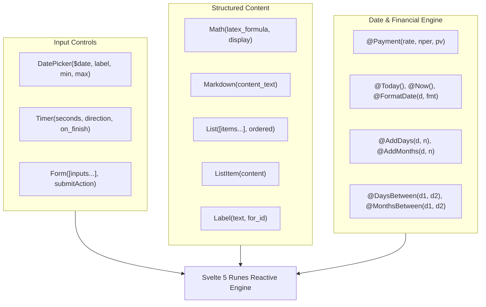

# 📋 Phase 16: OpenUI Form, Math, Content & Financial/Date Primitives

Dokumen ini mendokumentasikan spesifikasi arsitektur dan implementasi **Phase 16** pada Lumis OpenUI Engine, yang memperluas tata bahasa deklaratif dengan primitif input lanjutan (`DatePicker`, `Form`), tipografi terstruktur (`List`, `ListItem`, `Label`, `Markdown`, `Math`), serta pustaka fungsi bawaan tanggal & finansial.

---

## 🏛️ Latar Belakang & Kebutuhan Enterprise

Dalam operasional enterprise dan survei statistik:
1. **Perhitungan Finansial & Amortisasi**: Perhitungan kredit/angsuran anuitas (`PMT` / `@Payment`) membutuhkan rumus compound interest baku, bukan sekadar estimasi flat kasar.
2. **Manipulasi Tanggal**: Form reservasi, audit, dan timeline membutuhkan kalkulasi durasi hari kerja (`@DaysBetween`), proyeksi tenggat (`@AddDays`), dan batasan kalender (`DatePicker`).
3. **Penyajian Rumus & Form**: Tampilan formula matematika ilmiah memerlukan KaTeX (`Math`), serta formulir batch (`Form`) yang dapat mengirimkan sekumpulan input sekaligus via `@ToAssistant`.

---

## 📐 Arsitektur Komponen Baru (Tier 1)

---

## ⚡ Spesifikasi Primitif & Fungsi

### 1. Komponen Input & Form
- **`DatePicker($var, label, min, max)`**: Kalender pemilih tanggal interaktif dengan binding dua arah.
- **`Timer(seconds, direction, on_finish)`**: Penghitung mundur (*countdown*) atau maju (*stopwatch*).
- **`Form(children, submitAction)`**: Wadah yang mengelompokkan input dan memicu action dengan seluruh nilai state form saat disubmit.

### 2. Komponen Tipografi & Formula
- **`Math(formula, displayMode)`**: Render formula matematika presisi tinggi (LaTeX) berbasis KaTeX.
- **`Markdown(content)`**: Render teks kaya dengan format CommonMark di dalam komponen card.
- **`List(items, ordered)` & `ListItem(content)`**: Render daftar bernomor (*ordered*) atau berpoin (*unordered*).
- **`Label(text, for_id, required)`**: Label form mandiri dengan indikator wajib (*asterisk*).

### 3. Fungsi Finansial & Waktu (`@Builtins`)
- `@Payment(rate, nper, pv)`: Formula standar $PMT = \frac{pv \times rate}{1 - (1 + rate)^{-nper}}$.
- `@Today()`, `@Now()`: Mendapatkan tanggal/waktu saat ini (ISO format).
- `@AddDays(date, days)`, `@AddMonths(date, months)`: Proyeksi penambahan hari dan bulan.
- `@DaysBetween(d1, d2)`, `@MonthsBetween(d1, d2)`: Menghitung selisih durasi antara dua tanggal.
- `@Between(val, min, max)`: Evaluasi apakah suatu nilai berada di dalam rentang tertentu.

---

## 🛡️ Standar Kualitas & Batas Baris
- 100% berkas parser dan evaluator strictly `< 350 lines`.
- Zero-mock di seluruh alur evaluasi.
- Kompatibel dengan tema Google Sans & 120Hz/144Hz compositor animation.
