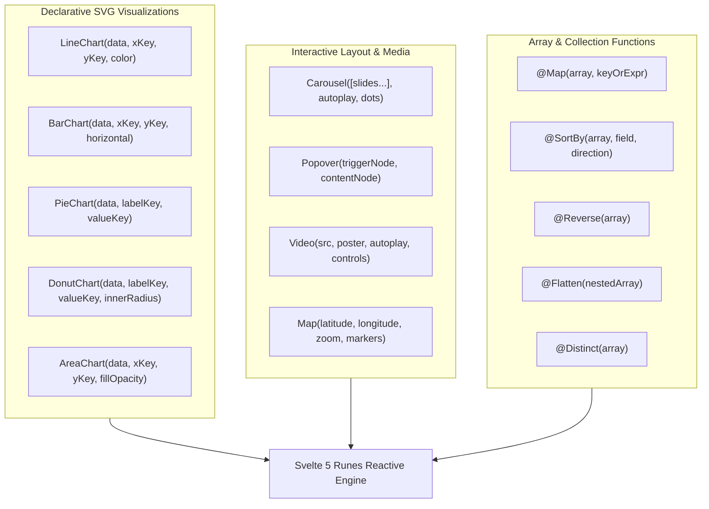

# 📊 Phase 17: OpenUI Declarative Data Visualizations (Charts & Media)

Dokumen ini mendokumentasikan spesifikasi arsitektur dan implementasi **Phase 17** pada Lumis OpenUI Engine, yang memperkenalkan visualisasi data deklaratif murni berbasis SVG tanpa dependensi eksternal berat (`LineChart`, `BarChart`, `PieChart`, `DonutChart`, `AreaChart`), tata letak interaktif (`Carousel`, `Popover`), serta primitif media (`Video`, `Map`).

---

## 🏛️ Latar Belakang & Kebutuhan Enterprise

Dalam pelaporan analitik, survei BPS, dan ringkasan eksekutif AI:
1. **Zero-Dependency Vector Graphics**: Pustaka visualisasi web eksternal (seperti Chart.js atau Highcharts) menambah bundle size ratusan KB dan sering mengalami layout reflow. Menggunakan pure SVG rendering di Svelte 5 menghasilkan performa 120fps/144fps instan dan footprint nol.
2. **Transformasi Data Sisi Klien**: Visualisasi membutuhkan fungsi pengolahan deret data seperti pemetaan array (`@Map`), sorting bersarang (`@SortBy`), pembalikan deret waktu (`@Reverse`), pemipaan unik (`@Distinct`), dan flattening hirarki (`@Flatten`).
3. **Penyajian Multi-Slide & Popover Detail**: Ringkasan data multi-metrik memerlukan `Carousel` untuk presentasi geser yang hemat ruang, serta `Popover` untuk inspeksi drill-down tanpa meninggalkan konteks obrolan.

---

## 📐 Arsitektur Komponen Baru (Tier 2)

---

## ⚡ Spesifikasi Primitif & Fungsi

### 1. Komponen Visualisasi Data (Pure SVG)
- **`LineChart(data, xKey, yKey, color, showAxes)`**: Visualisasi tren waktu dengan garis vektor mulus, titik penanda interaktif, dan label sumbu X/Y otomatis.
- **`BarChart(data, xKey, yKey, horizontal, color)`**: Grafik batang vertikal atau horizontal untuk komparasi metrik diskrit.
- **`PieChart(data, labelKey, valueKey)`** & **`DonutChart(...)`**: Diagram proporsi lingkaran dengan persentase dan legenda warna terintegrasi.
- **`AreaChart(data, xKey, yKey, gradient)`**: Visualisasi kumulatif volume di bawah kurva tren dengan gradien tembus pandang.

### 2. Komponen Media & Interaksi
- **`Carousel(slides, autoplay, loop)`**: Wadah slide gambar atau kartu interaktif dengan transisi GPU swipe halus dan indikator titik.
- **`Popover(trigger, content, position)`**: Panel apung kontekstual yang muncul saat tombol atau teks tertentu diklik.
- **`Video(src, poster, controls)`**: Pemutar video ringan dengan kontrol putar/jeda terintegrasi.
- **`Map(lat, lon, zoom, markers)`**: Penampil lokasi geografis berbasis koordinat dan penanda wilayah.

### 3. Fungsi Koleksi & Transformasi (`@Builtins`)
- `@Map(arr, key)`: Mengekstrak atribut spesifik dari daftar objek menjadi array nilai.
- `@SortBy(arr, field, dir)`: Mengurutkan deret data berdasarkan kolom numerik atau teks.
- `@Reverse(arr)`: Membalik urutan elemen dalam array.
- `@Flatten(arr)`: Meratakan array multidimensi menjadi satu dimensi.
- `@Distinct(arr)`: Menghilangkan duplikasi nilai dalam daftar.

---

## 🛡️ Standar Kualitas & Batas Baris
- Seluruh komponen grafik murni berbasis `<svg>` tanpa script pihak ketiga.
- 100% berkas strictly `< 350 lines`.
- Zero-mock di jalur rendering dan kalkulasi visual.
- Akselerasi animasi GPU transform-only ramah 120Hz/144Hz.
