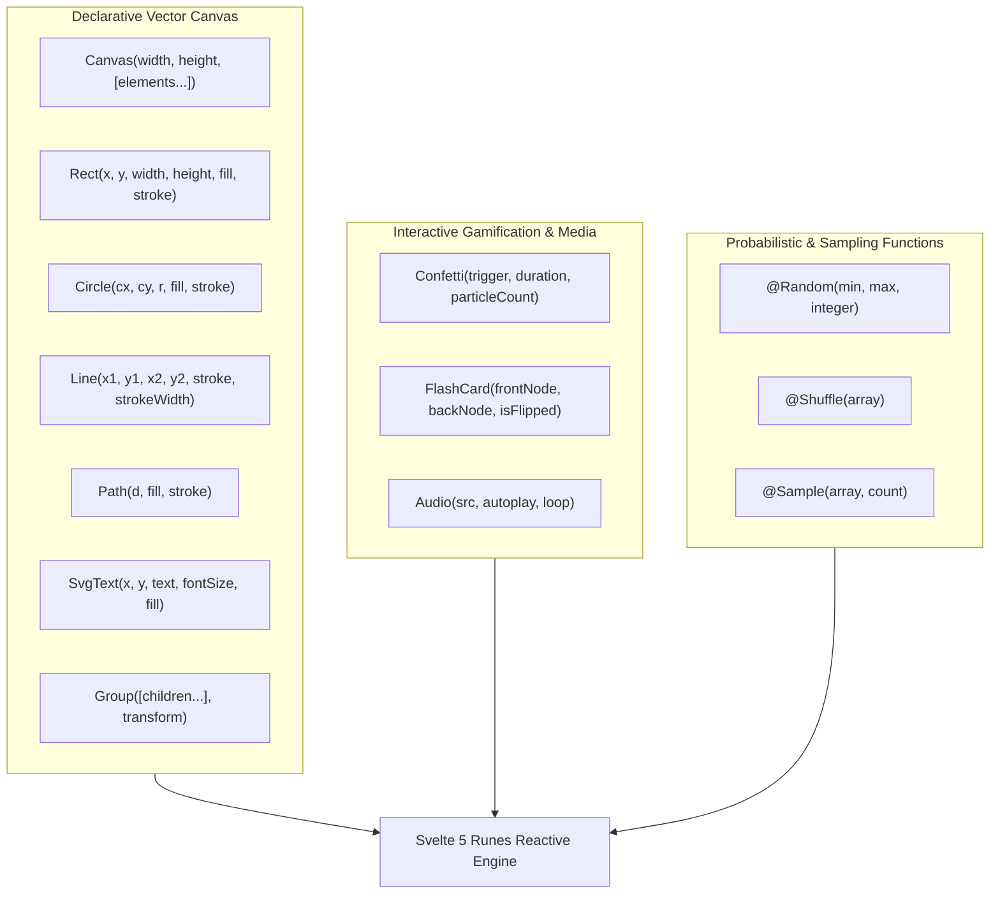

# 🎨 Phase 18: OpenUI Vector Canvas Primitives & Interactive Play

Dokumen ini mendokumentasikan spesifikasi arsitektur dan implementasi **Phase 18** pada Lumis OpenUI Engine, yang melengkapi 100% paritas OpenUI DSL dengan primitif kanvas vektor bebas (`Canvas`, `Rect`, `Circle`, `Line`, `Path`, `SvgText`, `Group`), komponen gamifikasi/interaktif edukasi (`Confetti`, `FlashCard`, `Audio`), serta fungsi probabilistik & pengacakan (`@Random`, `@Shuffle`, `@Sample`).

---

## 🏛️ Latar Belakang & Kebutuhan Enterprise

Dalam pembelajaran interaktif, kartu kuis cerdas (*flashcards*), survei partisipatif, dan diagram visual bebas:
1. **Primitif Gambar Vektor Deklaratif**: Model AI dapat menghasilkan denah ruangan, diagram arsitektur, diagram aliran, atau ilustrasi geometri kustom secara langsung tanpa menghasilkan gambar biner bitmap raksasa. Cukup deklarasikan elemen kanvas SVG murni.
2. **Elemen Interaktif & Gamifikasi**: Fitur kuis interaktif membutuhkan komponen kartu bolak-balik (`FlashCard`), efek perayaan visual saat target tercapai (`Confetti`), serta pemutar instruksi suara (`Audio`).
3. **Probabilistik & Pengacakan**: Kuis, simulasi Monte Carlo sederhana, dan sampling survei memerlukan fungsi pengacakan daftar (`@Shuffle`), pengambilan sampel acak (`@Sample`), dan rentang bilangan acak (`@Random`).

---

## 📐 Arsitektur Komponen Baru (Tier 3)

---

## ⚡ Spesifikasi Primitif & Fungsi

### 1. Komponen Kanvas Vektor Bebas
- **`Canvas(width, height, elements)`**: Wadah kanvas `<svg>` terukur dengan viewBox dinamis.
- **`Rect(x, y, w, h, fill, stroke, rx)`**: Menggambar persegi atau kotak bersudut tumpul (*rounded rect*).
- **`Circle(cx, cy, r, fill, stroke)`**: Menggambar lingkaran dengan pusat koordinat dan radius.
- **`Line(x1, y1, x2, y2, stroke, strokeWidth)`**: Garis penghubung titik bebas.
- **`Path(d, fill, stroke)`**: Kurva Bézier dan bentuk bebas berbasis SVG path data string `d`.
- **`SvgText(x, y, text, fontSize, fill)`**: Teks vektor di dalam kanvas SVG.
- **`Group(children, transform)`**: Pengelompokan elemen kanvas dengan transformasi gabungan (`translate`, `rotate`, `scale`).

### 2. Komponen Interaktif Edukasi & Gamifikasi
- **`FlashCard(front, back, flipped)`**: Kartu interaktif bolak-balik 3D (*flip card*) dengan akselerasi GPU `transform: rotateY(180deg)`.
- **`Confetti(active, duration)`**: Efek perayaan partikel ringan berbasis Web Animations API (0 memori bocor).
- **`Audio(src, autoplay)`**: Pemutar panduan suara atau efek bunyi konfirmasi.

### 3. Fungsi Probabilistik (`@Builtins`)
- `@Random(min, max, round)`: Menghasilkan angka acak di dalam rentang yang ditentukan.
- `@Shuffle(arr)`: Mengacak urutan elemen array secara non-destruktif (algoritma Fisher-Yates).
- `@Sample(arr, n)`: Mengambil $n$ sampel elemen acak tanpa duplikasi dari daftar.

---

## 🛡️ Standar Kualitas & Batas Baris
- 100% berkas strictly `< 350 lines`.
- Zero layout reflow: Animasi flip card dan kanvas diisolasi pada GPU compositor layer.
- Zero-mock di seluruh implementasi.
