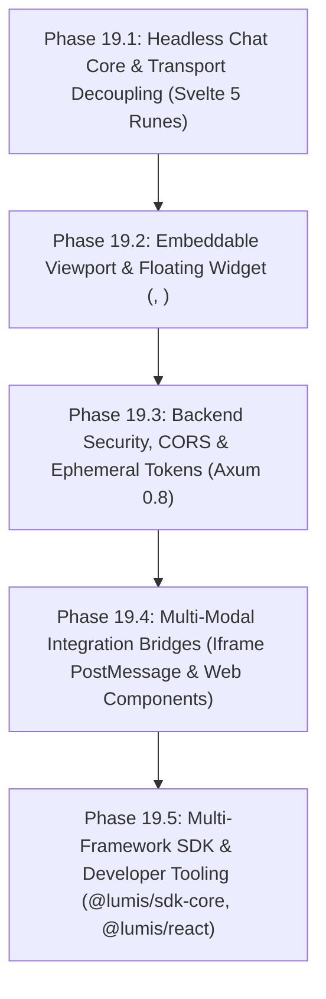

# Phase 19: Embeddable Chat SDK, Headless Core & EIP Integration for Existing SPAs

## 1. Executive Summary & Problem Formulation

### 1.1 Background & AS-IS Architecture
Platform percakapan enterprise **Lumis** saat ini dibangun sebagai portal web mandiri (*standalone monolithic web portal*):
- `ui/src/App.svelte` mengelola navigasi halaman penuh (`/login`, `/markdown`, `/chat/[id]`), otentikasi sesi cookie global (`/api/auth/me`), sidebar riwayat percakapan, header portal, dan pengaturan sistem dalam satu tata letak tunggal.
- Klien aplikasi internal enterprise (seperti dashboard operasional, CRM, ERP, atau sistem informasi kepegawaian) yang telah memiliki Single Page Application (SPA) sendiri membutuhkan **antarmuka chat Lumis atau mekanisme obrolan cerdasnya saja** untuk disematkan (*embedded*) di dalam aplikasi mereka tanpa memindahkan pengguna keluar dari alur kerja utama (*zero context switching*).

### 1.2 TO-BE Architectural Vision
Mendekonstruksi arsitektur Lumis menggunakan prinsip **SOLID** dan **Enterprise Integration Patterns (EIP)** untuk melahirkan arsitektur tri-modal (*Tri-Modal Delivery*):
1. **Headless Chat Engine & Transport (`@lumis/sdk-core`)**: State machine berbasis Svelte 5 Runes yang independen dari layout atau router URL.
2. **Embeddable Chat Components (`<ChatContainer />` & `<ChatWidget />`)**: Viewport obrolan mandiri dan floating launcher responsif berbasis `shadcn-svelte` dan GPU-composited 120fps.
3. **Multi-Modal Host Integration Adapters**:
   - **Iframe Bridge**: Rute terisolasi penuh (`/embed/chat` & `/embed/widget`) dengan bus komunikasi aman `postMessage` (RFC 6454).
   - **Custom Element**: Standar Web Component `<lumis-chat>` dan `<lumis-widget>`.
   - **Headless SDK Primitives**: Hooks dan adapter resmi untuk React, Svelte, dan Vanilla JS.

---

## 2. SOLID Architectural Decoupling

| Prinsip | Penerapan Arsitektur pada Lumis |
| :--- | :--- |
| **Single Responsibility (SRP)** | Memisahkan Transport Jaringan (`LumisTransport`), State Machine Pesan (`LumisChatEngine`), Viewport Presentasi (`ChatContainer`), dan Shell Aplikasi Portal (`App.svelte`). |
| **Open/Closed (OCP)** | Membuka titik ekstensi kustom (header actions, custom tool renderers OpenUI, theme variables, prompt filters) tanpa memodifikasi kode inti parser atau koneksi SSE. |
| **Liskov Substitution (LSP)** | Abstraksi `ILumisTransport` dapat diganti secara transparan antara `DirectHttpTransport`, `PostMessageTransport`, atau `MockTransport` saat pengujian. |
| **Interface Segregation (ISP)** | Memisahkan interface klien chat (`IChatClient`) dari antarmuka manajemen pengguna institusional (`IAdminClient`, `IScimClient`). |
| **Dependency Injection (DIP)** | Menghapus dependensi terhadap singleton global. Transport dan engine diinjeksikan melalui Svelte 5 Context (`setLumisContext()` / `getLumisContext()`). |

---

## 3. Enterprise Integration Patterns (EIP) Mapping

1. **Channel Adapter**:
   Modul Klien SDK bertindak sebagai jembatan yang menghubungkan lingkungan aplikasi host (React, Vue, Angular) dengan protokol backend Lumis Axum SSE streaming.
2. **Content Enricher**:
   Host SPA dapat menyuntikkan konteks runtime (misal: entitas data aktif, ID pelanggan, ID dokumen) secara otomatis ke dalam metadata sesi percakapan tanpa mengotori teks prompt visual pengguna.
3. **Pipes & Filters (Message Interceptors)**:
   Pipeline middleware sebelum pesan dikirim untuk audit internal atau pemeriksaan data sensitif di sisi klien host.
4. **Publish-Subscribe Event Bus (PostMessage RPC)**:
   Amplop pesan berstandar (*Envelope*) untuk komunikasi aman dwiarah antara host window dan iframe widget dengan correlation ID (UUID v4).
5. **Correlation Identifier & Request-Reply**:
   Mendukung eksekusi tool frontend (*Agentic In-App Actions*). Ketika model AI memerlukan aksi pada aplikasi host (seperti mengisi form atau memicu filter tabel), event dikirim ke host, dieksekusi lokal, dan hasilnya dikembalikan ke model.
6. **Idempotent Receiver**:
   Penetapan `client_message_id` unik pada setiap pengiriman pesan guna menjamin tidak terjadinya duplikasi respons saat koneksi terputus.

---

## 4. Phase-by-Phase Implementation Roadmap

### Phase 19.1: Headless Chat Core & Transport Decoupling
- Ekstraksi `ILumisTransport` (`src/lib/sdk/transport.ts`) dengan opsi `baseUrl`, headers, dan `getAuthToken`.
- Pembangunan `createLumisChat()` (`src/lib/sdk/chatEngine.svelte.ts`) menggunakan Svelte 5 Runes (`$state`, `$derived`).
- Refaktor `App.svelte` agar menggunakan `createLumisChat()` melalui Dependency Injection.

### Phase 19.2: Embeddable Component Hierarchy & Scoped Theming
- Pembangunan `<ChatContainer />` mandiri yang membungkus `MessageViewport`, `MessageInput`, dan kanvas artefak opsional.
- Pembangunan `<ChatWidget />` floating launcher button dengan animasi buka/tutup 120fps GPU compositor dan sheet mobile $\ge 44\text{px}$.
- Desain sistem token CSS Scoped menggunakan CSS custom properties ber-namespace `--lumis-*`.

### Phase 19.3: Backend Security, CORS & Ephemeral Tokens
- Konfigurasi middleware CORS `tower-http` pada `lumis-server` (`CORS_ALLOWED_ORIGINS`).
- Endpoint `POST /api/auth/embed-token` untuk penerbitan signed ephemeral JWT berbasis API Key server-to-server.
- Konfigurasi header CSP `frame-ancestors` untuk mitigasi serangan clickjacking.

### Phase 19.4: Multi-Modal Integration Bridges
- Pembuatan rute minimalis `/embed/chat` dan `/embed/widget` di UI Lumis.
- Pembuatan loader script 1-baris `lumis-embed.js` dengan handshake origin validasi RFC 6454.
- Kompilasi Svelte 5 Custom Element `<lumis-chat>` dan `<lumis-widget>`.
- Implementasi dispatcher eksekusi tool frontend (*Agentic In-App Actions*).

### Phase 19.5: Multi-Framework SDK Adapters & Distribution Packaging
- Pemaketan monorepo: `@lumis/sdk-core`, `@lumis/react`, `@lumis/svelte`, dan `lumis-embed.min.js`.
- Pembuatan aplikasi sandbox contoh (`examples/react-vite-spa`, `examples/plain-html-portal`).
- Verifikasi The Gauntlet: Line limits `< 350 lines`, zero mocks, parallel tests, dan UI hygiene compliance.

---

## 5. Engineering Invariants & Acceptance Criteria

1. **Strict Line Limits**: 100% berkas baru berukuran `< 350 lines` per file.
2. **Zero-Mock Policy**: Semua pengujian integrasi menggunakan harness live in-memory tanpa mock tiruan di jalur produksi.
3. **UI Hygiene Compliance**: 0 emoticon unicode, 100% tipografi Google Sans, komponen resmi `shadcn-svelte`, dan target sentuh mobile $\ge 44\text{px}$.
4. **Zero-Regression Invariant**: Seluruh fungsionalitas portal standalone `App.svelte` dan suite pengujian yang ada tetap lulus 100%.
